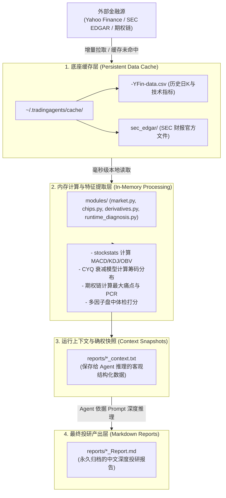

# Prompt 驱动模块化投研交易系统 (Prompt-based Modular Trading System)

本项目脱胎于 [TradingAgents](dependency/TradingAgents)，但**完全摒弃了 LangGraph 多 Agent 复杂状态流转与外部付费 AI API**。
系统采用**纯 Prompt 驱动的无状态轻量模块架构**。用户无需运行任何中间包装脚本（无 `runner.py`），直接由 Code Agent（如 Antigravity `agy`、`codex` 等自身）在对话中解析 Prompt、调用底层的 Python 金融模块获取确定性客观数据，并依据专业投研推理规范出具高质量的中文深度投研报告与盘中实时诊断。

---

## 📑 目录 (Table of Contents)

- [🌟 核心特性与架构优势](#-核心特性与架构优势)
- [📁 目录结构](#-目录结构)
- [📊 多周期全因子数据生成与 GUI 可视化体系 (Data Generation & GUI Engine)](#-多周期全因子数据生成与-gui-可视化体系-data-generation--gui-engine)
  - [1. 因子时间频率严密对齐原则 (Temporal Hierarchy)](#1-因子时间频率严密对齐原则-temporal-hierarchy)
  - [2. 标准三元组交付物 (Standard Triple Deliverables)](#2-标准三元组交付物-standard-triple-deliverables)
  - [3. 如何在 GUI 中查看生成的数据？](#3-如何在-gui-中查看生成的数据)
- [🎯 股票池智能选股与组合量化回测体系 (Stock Pool Screener & Portfolio Backtesting)](#-股票池智能选股与组合量化回测体系-stock-pool-screener--portfolio-backtesting)
  - [1. 预置多资产股票池宇宙 (Stock Pool Universes)](#1-预置多资产股票池宇宙-stock-pool-universes)
  - [2. 动态等权再平衡回测引擎 (Dynamic Portfolio Simulation Engine)](#2-动态等权再平衡回测引擎-dynamic-portfolio-simulation-engine)
  - [3. 多子图时间轴精确同步机制与 UX 规范 (Multi-Subplot Timeline Synchronization UX)](#3-多子图时间轴精确同步机制与-ux-规范-multi-subplot-timeline-synchronization-ux)
  - [4. 标准交付物与查阅方法](#4-标准交付物与查阅方法)
- [📈 高性能量化回测与绩效分析体系 (HFTBacktest / QuantStats / Plotly)](#-高性能量化回测与绩效分析体系-hftbacktest--quantstats--plotly)
- [💾 数据流转与持久化机制 (Data Handling & Storage)](#-数据流转与持久化机制-data-handling--storage)
- [🚀 交互使用指南 (Prompt Examples)](#-交互使用指南-prompt-examples)
  - [1. 盘中实时健康诊断与状态雷达（Market Time 体检首选）](#1-盘中实时健康诊断与状态雷达market-time-体检首选)
  - [2. 全维度综合投研报告（含技术面、筹码、期权期货、基本面、风控）](#2-全维度综合投研报告含技术面筹码期权期货基本面风控)
  - [3. 量化技术指标专项分析（MACD、KDJ、OBV、RSI、布林带）](#3-量化技术指标专项分析macdkdjobvrsi布林带)
  - [4. 筹码分布与持仓成本专项分析（获利盘、套牢峰、主力控盘度）](#4-筹码分布与持仓成本专项分析获利盘套牢峰主力控盘度)
  - [5. 期货 / 期权 / 正股跨资产联动分析（最大痛点、PCR、NQ/ES/VIX 传导）](#5-期货--期权--正股跨资产联动分析最大痛点pcrnqesvix-传导)
  - [6. 基本面与财报分析（估值、营收净利、现金流）](#6-基本面与财报分析估值营收净利现金流)
  - [7. 多周期全量量化数据生成与 GUI 交互可视化（日频/月频/季频时序与图形工作台）](#7-多周期全量量化数据生成与-gui-交互可视化日频月频季频时序与图形工作台)
  - [8. 股票池智能选股与组合量化回测（多因子筛选、对标基准、单票归因）](#8-股票池智能选股与组合量化回测多因子筛选对标基准单票归因)
- [🛠️ 后台执行逻辑（Code Agent 内部闭环）](#️-后台执行逻辑code-agent-内部闭环)

---

## 🌟 核心特性与架构优势

1. **直接由 Code Agent 担当投研大脑（零外部 AI API 成本）**：
   - 彻底摆脱对 OpenAI / Claude 等外部商业 API 的网络依赖与昂贵账单。
   - Code Agent 既是指令执行者又是顶级买方分析师，单次推理即可生成完整研报，耗时仅数秒，零 Token 浪费。
2. **直连成熟金融数据底座**：
   - 复用 [`dependency/TradingAgents/.venv`](dependency/TradingAgents/.venv) 中的数据引擎（`yfinance`、`sec-edgar`、`stockstats` 等）。
   - 具备**确定性确权快照（Verified Snapshot）**，彻底杜绝传统 LLM 在价格、涨跌幅、财务数字与技术指标上的幻觉捏造。
3. **盘中即时健康诊断雷达（Runtime Stock Diagnosis）**：
   - 支持在交易时间对标的进行全方位状态扫描（筹码水位、动量极值、期权痛点引力、宏观 Beta 溢出），秒级输出量化诊断得分（0-100）与可执行操作指引。
4. **全套全维度量化指标与衍生品体系**：
   - **技术面与经典指标**：MACD、KDJ、OBV 能量潮、RSI、布林带 (Bollinger Bands)、ATR、CCI、威廉指标 (WR)、均线系统 (EMA/SMA)、成交量加权均价 (VWMA)。
   - **筹码分布分析 (CYQ / Volume by Price)**：获利盘比例、套牢盘比例、全市场平均持仓成本、70%/90% 筹码集中度、主力套牢峰与支撑峰识别。
   - **期货 / 期权 / 正股跨资产联动 (默认以正股为锚)**：期权最大痛点 (Max Pain Price)、认沽/认购比率 (Put/Call Ratio - PCR)、期权隐含波动率 (IV)、纳指期货 (NQ) / 标普期货 (ES) 宏观 Beta 溢出、恐慌指数 (VIX)。

---

## 📁 目录结构

```
./
├── modules/                    # 纯函数式金融数据与量化计算模块
│   ├── indicators_engine.py    # 底层全量指标计算库 (MACD, KDJ, OBV, RSI, WR, CCI, Bollinger, ATR)
│   ├── backtest.py             # @backtest / @hftbacktest: 策略回测、QuantStats 绩效与 Plotly 交互报告
│   ├── stock_pool.py           # 股票池注册管理 (NASDAQ 核心池, TW50 台湾50池, US_SEMI 半导体池)
│   ├── screener.py             # @screener / @select: 股票池多因子筛选、组合动态回测与单票归因
│   ├── data_generator.py       # @data_generate: 多周期全因子数据生成与 Plotly GUI 图形工作台引擎
│   ├── taiwan.py               # @taiwan / @tw_chips: 台股三大法人买卖超、券商特殊地缘分点、千张大户筹码
│   ├── runtime_diagnosis.py    # @diagnosis / @runtime_diagnosis: 盘中实时健康诊断与状态雷达
│   ├── chips.py                # @chips: 筹码分布量化模块 (CYQ 换手衰减模型)
│   ├── derivatives.py          # @derivatives: 期权/期货/正股跨资产联动分析模块
│   ├── indicators.py           # @indicators: 技术指标提取与 15 日时序跟踪
│   ├── market.py               # @market: 技术面、量化指标与行情快照
│   ├── fundamentals.py         # @fundamentals: 核心估值(PE/PB/PEG)、利润表、现金流
│   ├── news.py                 # @news: 实时新闻、舆情与宏观行业事件
│   ├── risk.py                 # @risk: 波动率 ATR、回撤压力测试与止损区间
│   └── analyze.py              # @analyze: 一键聚合上述所有维度 (全维度全量数据)
├── prompts/                    # 中文投研推理规范与 Prompt 模板库
│   ├── backtest.md             # 量化策略回测与 QuantStats 绩效评估规范
│   ├── stock_selector.md       # 股票池智能选股与组合量化回测规范 (@screener / @select)
│   ├── data_generate.md        # 多周期全量量化因子数据生成与 GUI 交互可视化规范
│   ├── taiwan.md               # 台股三大法人与特殊地缘分点筹码分析规范
│   ├── runtime_diagnosis.md    # 盘中实时健康诊断与状态雷达规范
│   ├── full_report.md          # 顶级机构全维度综合投研报告大纲
│   ├── indicators.md           # 技术指标深度诊断规范 (MACD/KDJ/OBV等)
│   ├── chips.md                # 筹码分布量化专项分析规范
│   ├── derivatives.md          # 期货/期权/正股跨资产联动分析规范
│   ├── market.md               # 市场趋势与量化动量分析规范
│   └── fundamentals.md         # 基本面与财报分析规范
├── data/                       # 本地结构化行情数据存储 (Markdown & SQLite)
│   ├── qcom_2026.db            # QCOM 2026 年度 SQLite 数据库
│   ├── QCOM_2026_data.md       # QCOM 2026 年度每日 OHLCV 数据明细表
│   ├── export_qcom_data.py     # QCOM 数据导出脚本
│   ├── intc_2026.db            # INTC 2026 多周期全因子 SQLite 数据库
│   ├── INTC_2026_data.md       # INTC 2026 多周期全因子量化总账 (日频/月频/季频)
│   └── export_intc_data.py     # INTC 多周期数据生成脚本
├── docs/                       # 核心金融量化知识库 (Knowledge Base)
│   └── knowledge/
│       ├── technical_indicators.md # 技术指标百科 (CCI, WR, RSI, MACD, KDJ, BOLL, ATR, OBV)
│       ├── chips_distribution.md   # 筹码分布量化百科 (CYQ, 获利盘, 平均持仓成本, 密集峰)
│       ├── derivatives_linkage.md  # 衍生品联动百科 (Max Pain 期权最大痛点, PCR, 宏观期货)
│       └── taiwan_microstructure.md # 台股微观筹码百科 (三大法人, 竹科地缘分点, 千张大户)
├── templates/                  # 确定性报告 UI 与设计规范模板
│   └── report/
│       ├── plotly_theme.py     # 统一主题配色、字体与 ModeBar 交互规范
│       └── report_base.html    # 标准化 Jinja2 HTML 研报骨架
├── viewer.html                 # 根目录通用可视化浏览器 (WebAssembly SQLite + Plotly + Marked)
└── dependency/                 # 第三方上游依赖与环境
    └── TradingAgents/          # 上游数据流引擎与 Python 虚拟环境 (.venv)
```

---


---

## 📊 多周期全因子数据生成与 GUI 可视化体系 (Data Generation & GUI Engine)

系统内建了严格遵循金融工程时序分层的 **通用多周期数据生成与可视化引擎**（`@data_generate`），彻底解决不同周期指标混乱混杂的问题：

### 1. 因子时间频率严密对齐原则 (Temporal Hierarchy)
- **日频层 (Daily Level)**：
  - 股票日线 OHLCV（开、高、低、收、成交量、股息）；
  - **19 项核心量化指标**（10 EMA, 20 SMA, 50 SMA, 200 SMA, MACD, RSI, KDJ, WR, CCI, 布林带, ATR, OBV, VWMA，均经 5 年历史数据预热无空值）；
  - **每日滚动 CYQ 筹码分布**（逐日计算当日获利盘比例%、加权持仓成本、成本贴水率）；
  - **每日宏观大盘联动**（逐日对齐纳指 100 期货 `NQ=F` 收盘与涨跌幅、标普 500 期货 `ES=F`、恐慌指数 `^VIX`）。
- **月频层 (Monthly Level)**：
  - 聚合自然月度 K 线（月开、月高、月低、月收、月总成交量、月涨跌幅 %）；
  - 月末趋势与动能（月末 10 EMA, 50 SMA, 月末 RSI, 月末 MACDH 柱状图）；
  - 月末 CYQ 筹码盈亏比演变与加权成本迁移。
- **季频层 (Quarterly Level)**：
  - 季度财报真实经营业绩（营业收入、净利润、经营现金流 OCF、资本开支 Capex、自由现金流 FCF）；
  - 资产负债健康度与短期偿债防线（资产负债率 Debt-to-Equity %、流动比率 Current Ratio）。
- **年频/评估层 (Yearly / Priority Board)**：
  - 2026 年度统计概览（交易日数、年度最高/最低价、最新价）；
  - **全因子金字塔多空评估总看板**（Tier 1 决定级、Tier 2 主导级、Tier 3 触发级、Tier 4 辅助级）。

### 2. 标准三元组交付物 (Standard Triple Deliverables)
每次执行 `@data_generate`，系统将确定性输出以下 3 项交付物：
1. **SQLite 结构化数据库**：[`data/<ticker>_2026.db`](data/)  
   包含 5 张规范表：`stock_daily`, `daily_factors`, `monthly_factors`, `quarterly_fundamentals`, `factor_priority_board`。
2. **Markdown 结构化量化总账**：[`data/<TICKER>_2026_data.md`](data/)  
   排版清晰的长文档总账，包含各大周期全量时序数据表与全因子看板。
3. **Plotly 交互式 GUI 图形工作台**：[`reports/<TICKER>_2026_GUI.html`](reports/)  
   完全独立的现代暗黑模式 HTML 仪表盘，支持滚轮缩放、框选平移、多面板联动与数据检索。

### 3. 如何在 GUI 中查看生成的数据？
- **方式 0：使用通用可视化浏览器 (Universal Web Viewer) 拖拽打开任意 `.db` 或 `.md`（最强推荐）**
  ```bash
  # 桌面浏览器直接唤起通用浏览器
  xdg-open viewer.html

  # 或在本地 Web 服务中访问 (http://localhost:8080/viewer.html)
  dependency/TradingAgents/.venv/bin/python -m http.server 8080
  ```
  *功能特色：纯前端 WebAssembly SQLite (`sql.js`) + Plotly + Marked 架构。用户只需将任意股票的 `.db` 数据库或 `.md` 研报直接**拖拽**进网页，即可秒级无缝呈现全套 5-Tab 交互式 K线/筹码/动能副图（带贯穿全子图的激光准线）及带起止视窗和因子显隐开关的时序大表！*
- **方式 1：直接打开已生成的个股独立 GUI 工作台**
  ```bash
  xdg-open reports/INTC_2026_GUI.html
  ```
  *功能特色：多 Tab 切换、K线+均线+布林带+CYQ均价线同屏、CYQ获利盘面积图、MACD/RSI副图、NQ/VIX宏观叠加、鼠标滚轮自由缩放，以及历史数据明细表专属控制器（日频/月频/季频三大周期全覆盖：显式展示数据起止时间、用户自定义视窗起止筛选、各因子独立显隐开关）。*
- **方式 2：在 VS Code / Cursor 编辑器内浏览 SQLite 数据库**
  - 安装插件市场的 **`SQLite Viewer`** 扩展，在左侧文件树直接点击 `data/<ticker>_2026.db`，即可如 Excel 般分页浏览、排序、筛选全部数据表。
- **方式 3：使用桌面数据库管理软件**
  - 使用开源客户端查看：`sqlitebrowser data/<ticker>_2026.db`，或通过 DBeaver / DataGrip 连接。
- **方式 4：Markdown 原生预览**
  - 在编辑器打开 `data/<TICKER>_2026_data.md`，按 `Ctrl + Shift + V`（Mac: `Cmd + Shift + V`）快速查看格式化排版总账。

---

## 🎯 股票池智能选股与组合量化回测体系 (Stock Pool Screener & Portfolio Backtesting)

系统提供了面向多资产股票池的 **多因子条件选股、组合级动态再平衡回测与单票归因引擎**（`@screener` / `@select`），实现从单票分析向全市场/板块级多头量化策略的跨越：

### 1. 预置多资产股票池宇宙 (Stock Pool Universes)
内置针对不同市场与行业的代表性核心资产池（定义于 [`modules/stock_pool.py`](modules/stock_pool.py)），并与官方 ETF 基准精确绑定：
- **`NASDAQ` 纳斯达克核心池**：覆盖美股科技龙头（AAPL, MSFT, NVDA, AMZN, GOOGL, META, TSLA, AVGO, COST, PEP, ADBE, TXN, AMD, QCOM 等），官方对标基准为 **`QQQ`**。
- **`TW50` 台湾50核心池**：覆盖台股权重蓝筹（2330.TW 台积电, 2317.TW 鸿海, 2454.TW 联发科, 2308.TW 台达电, 2382.TW 广达, 2881.TW 富邦金等），官方对标基准为 **`0050.TW`**。
- **`US_SEMI` 美股半导体池**：覆盖全球半导体产业链核心巨头，官方对标基准为 **`SOXX`**。
- **开放架构**：支持用户随时注册自定义股票池（如沪深300核心、标普500高股息等）。

### 2. 动态等权再平衡回测引擎 (Dynamic Portfolio Simulation Engine)
- **多因子筛选器 (Condition Filtering)**：
  - 技术动量（MACD 零上金叉、RSI 处于超卖区间、均线多头排列、布林带突破）；
  - 筹码结构（CYQ 获利盘比例 > 80%、股价位于加权成本支撑上方）；
  - 波动率与基本面约束。
- **组合动态持仓模拟机制**：
  - **每日状态判定**：每个交易日 $t$ 全池扫描，确定当期满足条件的活跃标的集合 $S_t = \{s_1, s_2, \dots, s_k\}$；
  - **动态等权分配**：若 $k > 0$，资金均分为 $k$ 份等权配置于各标的，次日组合收益率计算为 $R_t = \frac{1}{k}\sum_{i=1}^k r_{i, t}$；
  - **空仓防御机制**：若某日池内无任何标的满足条件（$k=0$），策略自动进入全现金防御状态（当期收益率为 0%），规避系统性单边暴跌；
  - **Alpha 超额与绩效归因**：全程对齐基准 ETF（如 QQQ），输出策略净值、基准净值、相对 Alpha、夏普比率、索提诺比率、最大回撤与单票贡献排行。

### 3. 多子图时间轴精确同步机制与 UX 规范 (Multi-Subplot Timeline Synchronization UX)
为了解决量化交互研报中常见的**多子图滚动缩放脱节（Zoom/Pan Desynchronization）**问题，系统确立了严格的可视化架构规范：
- **时序面板严格同构绑定 (`matches="x"`)**：
  - 组合净值走势（Row 1）、动态水下回撤（Row 2）、每日入选持仓股票数（Row 3）三大时序面板，统一采用严格的日期时序（Date X 轴）；
  - 所有子图显式配置 `matches="x"`，确保鼠标滚轮缩放、框选放大、抓手平移时**三图毫秒级无缝联动同步**；
  - 跨多子图全高垂直十字光标同步 (Synchronized Multi-Subplot Laser Crosshair)：针对 Plotly 原生仅在光标所在单子图显示虚线的局限，内置专用激光十字准线引擎（`initSyncCrosshair`），鼠标在任意子图移动时，垂直指示线与浮动日期徽章毫秒级无缝贯穿所有子图（Row 1 至 Row N），实现与 TradingView 级别一致的全图时序精确对齐。
- **非时序图表解耦分离原则 (Decoupling Cross-Sectional Figures)**：
  - 单票风险收益截面散点图（X 轴为单票最大回撤 MDD %，Y 轴为区间累计收益率 %，气泡大小对应持仓天数）属于**截面统计维度而非时间序列**；
  - 系统将其独立为专属图表容器进行渲染，严禁将其作为子图与时间序列混排，从根源上杜绝不同坐标轴类型导致的 Plotly 轴同步崩溃。

### 4. 标准交付物与查阅方法
每次运行 `@screener` 或 `@select`，系统输出：
1. **交互式 GUI 工作台**：[`reports/<POOL>_<CONDITION>_<YEAR>_GUI.html`](reports/)
2. **深度投研与回测研报**：[`reports/<POOL>_<CONDITION>_<YEAR>_Report.md`](reports/)
3. **当前入选金叉池与个股排名**：终端与研报中直观列出当前处于买入状态的标的明细、最新收盘价、区间收益率与最大回撤。

---

## 📈 高性能量化回测与绩效分析体系 (HFTBacktest / QuantStats / Plotly)

系统集成了金融工程业界最主流的量化回测与评估三件套：
1. **高性能回测执行引擎 (HFTBacktest / Vectorized Engine)**：
   - 包含撮合滑点（Slippage）、双边手续费摩擦（Commission）与动态仓位管理。
   - 彻底摆脱多 Agent 循环的高昂 Token 成本与漫长等待，单次回测毫秒级完成。
2. **专业对冲基金级指标 (QuantStats)**：
   - 自动生成 **夏普比率 (Sharpe Ratio)**、**索提诺比率 (Sortino Ratio)**、**最大回撤 (Max Drawdown)**、**年化波动率**、**日胜率 (Win Rate)** 与 **阿尔法超额 (Alpha)**。
3. **基于 Jinja2 模板引擎的统一交互式研报 (Plotly Design System)**：
   - 为避免多次生成报告时界面风格或交互模式突变，系统建立了严格的确定性设计规范（`templates/report/`）：
     - **固定金融深色主题 (Dark Theme)**：规范统一的调色板（收益绿 `#00D084`、亏损红 `#FF4D4F`、科技蓝 `#38BDF8`、底色 `#14171F`）。
     - **顶部 5 大核心 KPI 仪表卡**：策略收益率、超额 Alpha、夏普/索提诺比率、最大回撤、期末净值与交易笔数。
     - **三栏时序联动图表**：策略资金净值 vs 买入持有基准（含买入/卖出三角标打点）、水下回撤深度曲面、MACD 动能柱状图。
     - **四位一体高级交互体验 (UX)**：
       1. **统一十字准线浮窗 (Hover Unified Tooltip)**：鼠标滑过任意日期，同时对比三栏图表的全部精确指标。
       2. **滚轮连续缩放 (Mouse Scroll Zoom)**：鼠标滚轮前后滚动，毫秒级自由拉伸/放大关注的时间跨度。
       3. **框选放大 (Box Zoom)**：按住左键直接拉出矩形框，松开即刻精准放大圈选区域。
       4. **自由拖拽平移 (Pan)**：右上角工具栏一键切换至“十字抓手（Pan）”，按住左键即可随意向左/右/上/下拖动画布。
       5. **双击空白处一键复原**：重置居中并恢复全量视图。

## 💾 数据流转与持久化机制 (Data Handling & Storage)

整个系统的数据流遵循 **“分层治理、按需拉取、本地确权缓存、成果归档”** 的全流程设计：



1. **增量拉取与本地缓存 (Smart Caching)**：
   - 优先读取本地持久化缓存（`~/.tradingagents/cache/<TICKER>-YFin-data.csv`）。若已有数据，**0 毫秒直接从本地读取**，避免频繁请求被风控；若缓存过时，仅对缺失的最新交易日发起增量抓取。
2. **纯内存计算与特征提取**：
   - 数据加载到内存后，由 `modules/` 进行纯内存向量化运算（技术指标、CYQ 换手率衰减模型、期权链最大痛点与 PCR 扫描、盘中状态评分）。
3. **严谨确权与双文件持久化**：
   - **`reports/<TICKER>_<DATE>_<MODULE>_context.txt`**：保存当次计算出的纯客观结构化数据，作为可溯源的原始数据凭证，防范模型幻觉。
   - **`reports/<TICKER>_<DATE>_Report.md`**：永久保存 Code Agent 生成的结构化中文投研报告。

---

## 🚀 交互使用指南 (Prompt Examples)

你无需在终端手动执行复杂命令行，直接在与 Code Agent（`agy` / `codex`）对话时发送 Prompt：

### 1. 盘中实时健康诊断与状态雷达（Market Time 体检首选）
> `use @diagnosis module to analyse qcom`  
> `use @runtime_diagnosis module to analyse tsla`  
> `use @diagnosis module to analyse nvda`

### 2. 全维度综合投研报告（含技术面、筹码、期权期货、基本面、风控）
> `use @analyze module to analyse qcom`  
> `use @analyze module to analyse tsla`

### 3. 量化技术指标专项分析（MACD、KDJ、OBV、RSI、布林带）
> `use @indicators module to analyse nvda`  
> `use @macd module to analyse aapl`  
> `use @kdj module to analyse msft`

### 4. 筹码分布与持仓成本专项分析（获利盘、套牢峰、主力控盘度）
> `use @chips module to analyse qcom`  
> `use @chips module to analyse nvda`

### 5. 期货 / 期权 / 正股跨资产联动分析（最大痛点、PCR、NQ/ES/VIX 传导）
> `use @derivatives module to analyse qcom`  
> `use @options module to analyse tsla`

### 6. 基本面与财报分析（估值、营收净利、现金流）
> `use @fundamentals module to analyse googl`

### 7. 多周期全量量化数据生成与 GUI 交互可视化（日频/月频/季频时序与图形工作台）
> `use @data_generate to generate data for nvda`  
> `use @data_generate for tsla`  
> `use @data_generate for intc`  
- 自动生成 SQLite 数据库：`data/<ticker>_2026.db`  
- 自动生成 Markdown 结构化总账：`data/<TICKER>_2026_data.md`  
- 自动生成 Plotly 交互式 GUI 图形工作台：`reports/<TICKER>_2026_GUI.html` (支持滚轮缩放与跨资产联动)

### 8. 股票池智能选股与组合量化回测（多因子筛选、对标基准、单票归因）
> `use @screener on nasdaq with macd from start of the year`  
> `use @select on tw50 condition: macd golden cross`  
> `use @screener module on us_semi with macd`  
- 自动多线程并行扫描股票池全部成分股  
- 动态模拟等权组合每日再平衡 vs 基准 ETF (QQQ / 0050.TW / SOXX)  
- 输出交互式组合回测工作台：`reports/<POOL>_<CONDITION>_<YEAR>_GUI.html`  
- 自动识别当前处于**金叉买入状态（Qualified）**的标的明细与单票收益排名

---

## 🛠️ 后台执行逻辑（Code Agent 内部闭环）
当你发出 Prompt 后，Code Agent 会自动在后台执行以下链路：
1. **指令解析**：提取目标模块（如 `@diagnosis` 或 `@analyze`）与标的代码（如 `QCOM`）。
2. **模块执行**：调用 `dependency/TradingAgents/.venv/bin/python` 执行对应的模块提取函数（如 `fetch_diagnosis_data`）。
3. **数据注入**：读取 `prompts/` 目录中的标准规范，将确权客观数据组装为完整的推理上下文。
4. **研报生成**：Agent 依据规范出具具备买卖评级、支撑阻力位、仓位计划的中文深度报告，并持久化至 `reports/` 目录。
