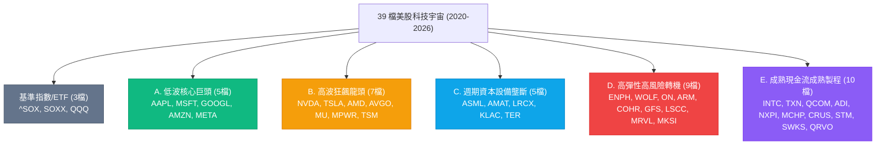

# 美股半導體 SOX 30 與科技七巨頭 Mag 7 純價格與量波類型 (Price & Vol Only) 量化研究報告

**研究主題**：基於價格漂移（Price Drift）與波動擴散（Volatility Diffusion）兩大純粹物理維度的美股半導體龍頭與科技七巨頭體制劃分與標的群聚研究  
**數據樣本**：費城半導體指數（SOX 30 成分股）+ 科技七巨頭（Mag 7）共 39 檔標的（含 3 檔基準指數/ETF）  
**時間跨度**：2020-01-02 至 2026-11-10（全樣本 1,724 個交易日，總計 60,399 根有效逐日 K 線）  
**輸出目錄**：`data/sox_mag7_price_vol_types/`  
**核心成果**：
1. 演算法與資料處理腳本：`analyze_price_vol.py`
2. 結構化 SQLite 量化資料庫：`price_vol_analysis.db`（12.83 MB）
3. 前端結構化傳輸 JSON：`price_vol_summary.json`（988 KB）
4. 互動式單一 HTML 視覺化檢視器：`build_price_vol_viewer.py` 與 `price_vol_viewer.html`（9.59 MB）
5. 本量化深度研究報告：`price_vol_report.md`

---

## 目錄
1. [執行摘要 (Executive Summary)](#1-執行摘要-executive-summary)
2. [理論架構與數學建模 (Theoretical Framework & Formulations)](#2-理論架構與數學建模-theoretical-framework--formulations)
   - 2.1 為何僅使用「純價格與量波 (Price & Vol Only)」？
   - 2.2 核心指標定義：季度淨位移動量 $\mu_{60}$、實現波動率 $\sigma_{60}$、相對量能 $RVol_{60}$
   - 2.3 6 大宏觀體制（Regime Matrix）定義
   - 2.4 宏觀平滑演算法（Topological Drift-Preserving Smoothing, $\ge 20$ 天）
3. [全市場宏觀體制實證結果 (Full Market Empirical Regime Findings)](#3-全市場宏觀體制實證結果-full-market-empirical-regime-findings)
   - 3.1 962 個宏觀週期總體統計分析
   - 3.2 6 大體制的微觀金融經濟學特質深入解構
4. [5 大標的原型深度剖析 (Stock-Level Archetypes)](#4-5-大標的原型深度剖析-stock-level-archetypes)
   - 4.1 原型定義與投資哲學
   - 4.2 39 檔標的全景歸屬與核心績效矩陣
   - 4.3 原型間的幾何邊界與量化特徵對比
5. [SOX 族群 vs Mag 7 族群之結構性本質差異 (SOX vs Mag 7 Deep Dive)](#5-sox-族群-vs-mag-7-族群之結構性本質差異-sox-vs-mag-7-deep-dive)
   - 5.1 波動率結構的懸殊鴻溝（34.9% vs 46.2%）
   - 5.2 多空與高低波時間分配的不對稱性（58.2% 低波 vs 75.0% 高波）
   - 5.3 資本效率與夏普比率的根本落差（0.54 vs 0.32）
   - 5.4 NVIDIA (NVDA) 作為兩者交集的「雙重主權」現象
6. [代表性標的案例深入剖析 (Representative Case Studies)](#6-代表性標的案例深入剖析-representative-case-studies)
   - 6.1 NVDA：高波狂飆龍頭（Type 2 噴出狂歡的極致演繹）
   - 6.2 MSFT & AAPL：低波核心巨頭（Type 1 穩健主升與 Type 3 壓縮的複利基石）
   - 6.3 ASML：週期性資本設備壟斷者（晶圓廠 Capex 循環與 Type 2/4 交替）
   - 6.4 ENPH：高彈性轉機股（Type 2 狂熱噴出到 Type 5 恐慌瀑布的過山車）
   - 6.5 INTC：成熟現金流科技的轉型困局（長年無量陰跌與高波震盪）
7. [量化交易與資產配置啟示 (Quantitative Implications)](#7-量化交易與資產配置啟示-quantitative-implications)
8. [結論與後續工程延伸 (Conclusion & Roadmap)](#8-結論與後續工程延伸-conclusion--roadmap)

---

## 1. 執行摘要 (Executive Summary)

傳統技術分析往往受困於指標重疊、參數過擬合（Overfitting）與基本面雜訊干擾。本研究回歸金融市場最純粹、最不可偽造的「兩大物理維度」——**價格位移（Price Drift, 趨勢方向）** 與 **波動擴散（Volatility Diffusion, 價格分佈擴散率）**，結合成交量強度輔助驗證，構建了一套完整的宏觀體制分類體系。

我們對 2020 年 1 月至 2026 年 11 月期間的美股半導體龍頭（SOX 30 成分股）與科技七巨頭（Mag 7）進行了全樣本回溯實證（共 39 檔標的，60,399 根有效交易日數據），得出以下重大量化結論：

1. **體制層（Period Regimes）的分水嶺效應**：
   - 全市場萃取出 **962 個宏觀連續週期**（平均週期長度 64.1 天，約一季度）。
   - **Type 1（穩健低波主升）** 是全市場性價比最高的體制，勝率達 **84.43%**，平均夏普比率高達 **2.80**，最大回撤僅 **-9.27%**，是機構法人資本最偏好的擴張期。
   - **Type 2（狂熱高波噴出）** 平均週期報酬達 **+35.24%**（衝升幅度達 **+68.38%**），但伴隨 **-17.75%** 的劇烈回撤與 48.37% 的年化波動率，屬於高報酬伴隨高回撤的衝頂盛宴。
   - **Type 5（高波恐慌瀑布）** 平均回撤達 **-23.16%**，勝率跌破 40%，且伴隨 **1.06x** 的恐慌爆量，反映保證金斷頭與流動性擠兌。
   - **Type 6（無量陰跌失血）** 呈現「溫水煮青蛙」，平均夏普比率跌至 **-0.05**，買盤極度枯竭。

2. **SOX 族群 vs Mag 7 族群的結構性鴻溝**：
   - **Mag 7（排除 NVDA）** 表現出顯著的「**低波複利特徵**」：長期中位數 HV60 僅 **34.93%**，全生命週期中高達 **58.19%** 的時間處於低波體制（Type 1 與 Type 3），平均年化複合報酬率（CAGR）為 **24.59%**，夏普比率高達 **0.54**，平均最大回撤控制在 **-53.64%**。
   - **SOX 30（排除 NVDA）** 表現出鮮明的「**高波週期硬體特徵**」：長期中位數 HV60 高達 **46.21%**（較 Mag 7 高出近 12 個百分點），高達 **75.04%** 的時間處於高波體制（Type 2 佔 32.0%、Type 4 佔 22.1%、Type 5 佔 20.9%），平均 CAGR 為 **19.55%**，夏普比率僅 **0.32**，平均最大回撤達 **-58.17%**。
   - **NVDA 的「雙重主權」現象**：兼具 SOX 半導體與 Mag 7 身分的 NVDA，在 2020-2026 年創下了 **62.71% CAGR** 與 **1.16 夏普比率** 的超常績效。其高達 **47.72%** 的時間處於 Type 2 狂熱噴出期，成功將半導體的高 Beta 動量轉化為超級巨頭的市值擴張。

3. **5 大標的原型（Stock Archetypes）**：
   - **A. 低波核心巨頭 (Mega-Cap Low-Vol Titans)**：AAPL, MSFT, GOOGL, AMZN, META（低波時間佔 69.1%，夏普 0.51）
   - **B. 高波狂飆龍頭 (Hyper-Growth Momentum Leaders)**：NVDA, TSLA, AMD, AVGO, MU, MPWR, TSM（平均 CAGR 43.1%，夏普 0.77）
   - **C. 週期性資本設備壟斷者 (Cyclical Semi Equipment Giants)**：ASML, AMAT, LRCX, KLAC, TER（平均 CAGR 29.4%，受晶圓廠 Capex 週期拉扯）
   - **D. 高彈性高風險轉機股 (High-Beta Speculative / Turnarounds)**：ENPH, WOLF, ON, ARM, COHR, GFS, LSCC, MRVL, MKSI（波動率達 68.5%，回撤深達 -69.4%）
   - **E. 成熟現金流成熟製程 (Mature Cash-Cow Tech)**：INTC, TXN, QCOM, ADI, NXPI, MCHP, CRUS, STM, SWKS, QRVO（平均 CAGR 僅 6.1%，長期處於壓縮盤整）

---

## 2. 理論架構與數學建模 (Theoretical Framework & Formulations)

### 2.1 為何僅使用「純價格與量波 (Price & Vol Only)」？

金融市場的報價數據本質上由交易撮合系統生成，唯一不可偽造且具備連續時間物理意義的即為 **成交價格 (Price)** 與 **成交量 (Volume)**。
根據金融隨機分析（Stochastic Calculus）與幾何布朗運動（Geometric Brownian Motion）：
$$dS_t = \mu(t, S_t) S_t dt + \sigma(t, S_t) S_t dW_t$$

資產走勢由兩大正交分量決定：
1. **漂移項（Drift $\mu$）**：反映資本淨流入流出帶動的趨勢位移。
2. **擴散項（Diffusion $\sigma$）**：反映資訊衝擊、流動性厚度與市場分歧度帶來的波動率擴散。

本研究完全不使用任何落後技術指標（如 RSI 超買超賣、MACD 交叉等主觀信號），而是將時間序列投影於 $\mu$ 與 $\sigma$ 構成的二維金融物理相空間（Phase Space）。

### 2.2 核心指標定義

#### (1) 季度價格淨位移動量（Price Drift $\mu_{60}$）
以 60 個交易日（約一季度，宏觀機構投資者的調倉週期）為滾動回顧視窗：
$$\mu_{60, t} = \left( \frac{Close_t}{Close_{t-60}} - 1.0 \right) \times 100\%$$
- **多頭漂移（Bull Drift）**：$\mu_{60} > +10\%$
- **中性蓄勢（Flat Drift）**：$-10\% \le \mu_{60} \le +10\%$
- **空頭漂移（Bear Drift）**：$\mu_{60} < -10\%$

#### (2) 60 日年化實現波動率（Volatility Diffusion $\sigma_{60}$）
基於對數日報酬率（Log Returns）標準差之年化計算：
$$r_t = \ln\left(\frac{Close_t}{Close_{t-1}}\right)$$
$$\sigma_{60, t} = \sqrt{\frac{252}{59} \sum_{k=0}^{59} (r_{t-k} - \bar{r})^2} \times 100\%$$

- **波動率定錨界限**：$\sigma = 35\%$。
  - 美股大型科技股與指數的長期波動率中樞約為 25%~30%，而高彈性晶片股的波動中樞在 45%~60%。因此，**35% 是劃分低波動穩健資產與高波動風險資產的最具經濟與統計顯著性的分水嶺**。
  - **低波動狀態（Low Vol）**：$\sigma_{60} \le 35\%$
  - **高波動狀態（High Vol）**：$\sigma_{60} > 35\%$

#### (3) 相對成交量強度（Relative Volume Intensity $RVol_{60}$）
$$RVol_{60, t} = \frac{Volume_t}{\frac{1}{60} \sum_{k=0}^{59} Volume_{t-k}}$$
用於檢驗價格在極端位移時是否伴隨機構資金的量能爆發或流動性衰竭。

---

### 2.3 6 大宏觀體制（Regime Matrix）定義

透過 3 種趨勢漂移狀態（Up, Flat, Down）與 2 種波動擴散狀態（Low Vol, High Vol）的笛卡兒積（Cartesian Product），構建 6 大互斥的宏觀體制：

| 體制代碼 | 體制名稱 (Regime Name) | 趨勢動量 $\mu_{60}$ | 實現波動率 $\sigma_{60}$ | 量能特徵 $RVol$ | 典型市場情境與機構行為 |
| :--- | :--- | :---: | :---: | :---: | :--- |
| **Type 1** | **穩健低波主升**<br>*(Low-Vol Steady Compounder)* | $\mu > +10\%$ | $\sigma \le 35\%$ | 平穩或溫和放大 | **機構吸籌主升**：資金秩序井然推升，回撤極小，夏普比率最高 |
| **Type 2** | **狂熱高波噴出**<br>*(High-Vol Momentum Climax)* | $\mu > +10\%$ | $\sigma > 35\%$ | 放量狂熱 | **散戶動量狂歡**：價格極速飆升，市場情緒極度亢奮，但巨幅洗盤頻繁 |
| **Type 3** | **低波壓縮蓄勢**<br>*(Low-Vol Squeeze Base)* | $-10\% \le \mu \le +10\%$ | $\sigma \le 35\%$ | 量縮窒息 | **箱型築底醞釀**：波動率降至冰點，均線高度收斂，醞釀下一輪宏觀大突破 |
| **Type 4** | **高波劇烈洗盤**<br>*(High-Vol Battleground Chop)* | $-10\% \le \mu \le +10\%$ | $\sigma > 35\%$ | 多空對敲放量 | **多空修羅場**：假突破、假跌破頻繁，價格大幅震盪但季度淨位移停滯，趨勢策略雙巴 |
| **Type 5** | **高波恐慌瀑布**<br>*(High-Vol Panic Liquidation)* | $\mu < -10\%$ | $\sigma > 35\%$ | 恐慌爆量 | **流動性踩踏殺跌**：保證金斷頭、停損單引發骨牌效應，價格垂直下墜，回撤最深 |
| **Type 6** | **無量陰跌失血**<br>*(Low-Vol Despair Bleed)* | $\mu < -10\%$ | $\sigma \le 35\%$ | 買盤衰竭量縮 | **溫水煮青蛙**：無恐慌拋盤但買方徹底撤離，價格緩步盤跌，持股者在漫長折磨中虧損 |

---

### 2.4 宏觀平滑演算法（Topological Drift-Preserving Smoothing）

原始逐日分類會因市場雜訊產生小於 5~10 天的頻繁跳動（Chattering / Flicker）。為了提取真正具備跨季度配置價值的宏觀週期，本系統設計了專屬的平滑演算法：

1. **最小週期長度約束**：強制所有宏觀體制持續天數 $T \ge 20$ 個交易日（約 1 個日曆月）。
2. **邊界保留機制**：對於資料集末端的當前進行中週期，若天數 $\ge 5$ 天予以保留，以反映即時市場最新狀態。
3. **拓撲趨勢保真合併準則（Topological Drift Preference）**：
   - 當某一短週期長度 $< 20$ 天時，優先將其合併入具有 **相同基礎趨勢漂移（Same Drift: UP, FLAT, DOWN）** 的相鄰週期中。
   - 例如：一段長達 60 天的 Type 1（穩健主升）中若出現 6 天的 Type 2（短暫高波噴出），演算法會將其平滑合併為 Type 1，以維持宏觀主升趨勢的連續性；
   - 若前後鄰居的漂移方向皆不相同，則合併入持續天數較長的相鄰主週期中。

經過該演算法處理後，全市場 38 檔有效標的平均每檔僅產生約 25.3 個宏觀週期，平均持續長度達 **64.1 天**，完美對應一季度的宏觀調倉窗口。

---

## 3. 全市場宏觀體制實證結果 (Full Market Empirical Regime Findings)

### 3.1 962 個宏觀週期總體統計分析

在 2020 年至 2026 年的全市場實證中，全市場 38 檔標的（QRVO 因僅有 1 筆歷史數據暫略）共萃取出 **962 個宏觀週期**，覆蓋 60,399 根有效交易日 K 線。

以下為 6 大體制的完整統計表現：

| 體制代碼 | 體制中文名稱 | 總週期數 | 涵蓋總天數 | 時間佔比 (%) | 平均天數 | 平均週期報酬 | 週期勝率 (%) | 年化平均報酬 | 平均最大回撤 | 平均最大衝升 | 實現波動率 | 平均夏普比率 | 平均 $RVol$ |
| :--- | :--- | :---: | :---: | :---: | :---: | :---: | :---: | :---: | :---: | :---: | :---: | :---: | :---: |
| **Type 1** | **穩健低波主升** | 122 | 7,788 | 12.89% | 63.8 天 | **+16.02%** | **84.43%** | +85.31% | **-9.27%** | +25.18% | 29.73% | **2.80** | 0.99x |
| **Type 2** | **狂熱高波噴出** | 219 | 16,985 | **28.12%** | **77.6 天** | **+35.24%** | 77.17% | **+108.95%** | -17.75% | **+68.38%** | 48.37% | 2.44 | 1.00x |
| **Type 3** | **低波壓縮蓄勢** | 144 | 10,647 | 17.63% | 73.9 天 | +3.09% | 63.19% | +38.22% | -12.47% | +16.54% | 30.28% | 1.14 | 1.02x |
| **Type 4** | **高波劇烈洗盤** | 253 | 12,614 | 20.88% | 49.9 天 | +2.10% | 57.71% | +76.58% | -15.40% | +20.75% | 45.12% | 1.74 | 0.98x |
| **Type 5** | **高波恐慌瀑布** | 188 | 11,054 | 18.30% | 58.8 天 | **-5.28%** | 39.36% | +51.40% | **-23.16%** | +25.37% | **57.87%** | 0.73 | **1.06x** |
| **Type 6** | **無量陰跌失血** | 36 | 1,311 | 2.17% | 36.4 天 | -2.22% | 41.67% | -3.47% | -12.18% | +10.94% | 30.53% | **-0.05** | 1.06x |
| **全市場匯總** | **全部 6 大體制** | **962** | **60,399** | **100.00%** | **62.8 天** | **+11.83%** | **67.05%** | **+73.81%** | **-15.66%** | **+36.48%** | **44.02%** | **1.83** | **1.01x** |

---

### 3.2 6 大體制的微觀金融經濟學特質深入解構

#### 1. Type 1: 穩健低波主升 —— 機構性價比之王
- **實證特徵**：全市場平均夏普比率高達 **2.80**，勝率高達 **84.43%**，平均最大回撤僅 **-9.27%**。在長達 63.8 天的季度主升中，平均穩健斬獲 **+16.02%** 的絕對收益。
- **金融本質**：該體制反映大型公募與被動主權基金的持續定投與低衝擊建倉。股價沿 20 日與 60 日移動均線穩步推升，極少發生單日暴跌。
- **最典型代表**：AAPL（穩健主升佔比 33.5%）、GOOGL（38.6%）、MSFT（27.3%）、ADI（23.4%）、AVGO（22.8%）。

#### 2. Type 2: 狂熱高波噴出 —— 巨幅超額收益與劇烈回撤同生
- **實證特徵**：全市場佔比最高（**28.12%** 的交易日處於此狀態），平均持續時間最長（**77.6 天**）。平均週期報酬高達 **+35.24%**，週期內最大衝升幅度平均達 **+68.38%**，年化報酬高達 **+108.95%**！然而，其代價是高達 **48.37%** 的波動率與 **-17.75%** 的波段回撤。
- **金融本質**：由散戶狂熱、Gamma Squeeze、動量追高盤與 FOMO 情緒推動。成交量維持高檔，趨勢極其強勁，是創造「數倍牛股」的唯一溫床，但若缺乏動態移動停利，極易在頂部承受大幅回吐。
- **最典型代表**：NVDA（佔比 47.7%）、AMD（45.5%）、ARM（46.7%）、TSLA（41.8%）、MPWR（43.9%）。

#### 3. Type 3: 低波壓縮蓄勢 —— 大級別趨勢的孵化器
- **實證特徵**：佔比 **17.63%**，平均持續 73.9 天。報酬率接近零軸（+3.09%），實現波動率壓低至 **30.28%**。
- **金融本質**：市場處於多空暫時平衡、獲利盤消化完畢、成交量收斂的「平靜之眼」。此階段是價值型投資者進行左側佈局的最佳時機。
- **最典型代表**：AAPL（蓄勢佔比 42.8%）、AMZN（36.9%）、ADI（41.3%）、TXN（42.5%）。

#### 4. Type 4: 高波劇烈洗盤 —— 趨勢投資者的修羅場
- **實證特徵**：佔比 **20.88%**，週期平均僅 49.9 天。雖然淨報酬接近平盤（+2.10%），但實現波動率高達 **45.12%**，週期內平均回撤達 **-15.40%**。
- **金融本質**：機構高檔出貨與抄底資金劇烈交鋒。均線反覆糾纏交叉，任何以均線突破為買訊的順勢策略在該體制中勝率低且極易被雙向停損侵蝕本金。

#### 5. Type 5: 高波恐慌瀑布 —— 流動性枯竭與多頭斷鏈
- **實證特徵**：佔比 **18.30%**，週期平均回撤深達 **-23.16%**，勝率驟降至 **39.36%**，年化實現波動率飆升至 **57.87%**，且成交量顯著放大（$RVol = 1.06$）。
- **金融本質**：多頭槓桿斷頭盤湧出，流動性提供者退場，報價單薄弱，呈現連續性跳空殺跌。
- **最典型代表**：ENPH（恐慌瀑布佔比 41.4%）、WOLF（45.9%）、COHR（27.5%）、INTC（26.1%）。

#### 6. Type 6: 無量陰跌失血 —— 溫水煮青蛙的長期折磨
- **實證特徵**：佔比僅 **2.17%**（極為罕見），平均持續 36.4 天，夏普比率為全市場唯一的負值（**-0.05**）。
- **金融本質**：該體制通常發生在基本面徹底衰退、市場關注度完全轉移的邊緣化股票中。雖無恐慌拋盤，但買盤完全枯竭，價格緩步陰跌，反彈極度無力。

---

## 4. 5 大標的原型深度剖析 (Stock-Level Archetypes)

### 4.1 原型定義與投資哲學

為了將 39 檔標的從「逐日體制」升華至「標的固有特質（Stock DNA）」，我們依據標的在 2020–2026 年的長期價格動量、波動分佈、最大回撤與業務模式，劃分為 5 大經典原型：



---

### 4.2 39 檔標的全景歸屬與核心績效矩陣

下表展示了全市場 39 檔標的的量化特徵與原型歸屬：

| 代碼 | 名稱 | 所屬族群 | 標的原型代碼 | 標的原型中文名稱 | CAGR (%) | 年化波動率 (%) | 中位數 HV60 (%) | 最大回撤 (%) | 夏普比率 | 多頭佔比 (%) | 空頭佔比 (%) | 高波佔比 (%) |
| :--- | :--- | :--- | :--- | :--- | :---: | :---: | :---: | :---: | :---: | :---: | :---: | :---: |
| **NVDA** | NVIDIA Corporation | SOX_MAG7 | **B** | 高波狂飆龍頭 | **+62.71%** | 51.42% | 47.63% | -66.36% | **1.16** | 57.99% | 15.81% | 85.10% |
| **TSLA** | Tesla Inc. | MAG7 | **B** | 高波狂飆龍頭 | **+45.77%** | 64.28% | 59.10% | -73.63% | 0.67 | 47.72% | 29.33% | 96.57% |
| **MU** | Micron Technology | SOX | **B** | 高波狂飆龍頭 | **+45.52%** | 55.84% | 46.40% | -57.77% | 0.76 | 44.59% | 21.51% | 88.22% |
| **AMD** | Advanced Micro Devices | SOX | **B** | 高波狂飆龍頭 | **+40.90%** | 56.75% | 51.75% | -65.37% | 0.67 | 49.94% | 24.52% | 97.30% |
| **AVGO** | Broadcom Inc. | SOX | **B** | 高波狂飆龍頭 | **+40.51%** | 44.24% | 37.92% | -48.31% | **0.85** | 48.98% | 9.68% | 62.62% |
| **ARM** | Arm Holdings plc | SOX | **D** | 高彈性高風險轉機 | +39.41% | 75.25% | 71.60% | -62.14% | 0.48 | 47.48% | 27.97% | 100.00% |
| **KLAC** | KLA Corporation | SOX | **C** | 週期性資本設備 | +36.35% | 49.02% | 42.23% | -56.96% | 0.68 | 53.85% | 15.69% | 70.37% |
| **MPWR** | Monolithic Power | SOX | **B** | 高波狂飆龍頭 | +34.27% | 55.29% | 50.51% | -51.93% | 0.57 | 49.94% | 15.99% | 94.29% |
| **LRCX** | Lam Research | SOX | **C** | 週期性資本設備 | +34.08% | 52.22% | 45.61% | -57.34% | 0.60 | 48.02% | 21.81% | 77.64% |
| **TSM** | Taiwan Semi ADR | SOX | **B** | 高波狂飆龍頭 | +31.70% | 39.40% | 36.80% | -57.10% | 0.73 | 52.16% | 12.50% | 70.49% |
| **COHR** | Coherent Corp. | SOX | **D** | 高彈性高風險轉機 | +30.13% | 65.51% | 55.89% | -72.24% | 0.41 | 47.36% | 28.00% | 94.89% |
| **AMAT** | Applied Materials | SOX | **C** | 週期性資本設備 | +29.77% | 49.71% | 43.96% | -55.83% | 0.54 | 46.21% | 19.41% | 77.10% |
| **LSCC** | Lattice Semi | SOX | **D** | 高彈性高風險轉機 | +29.02% | 55.85% | 51.41% | -61.12% | 0.47 | 46.63% | 24.58% | 95.37% |
| **MRVL** | Marvell Technology | SOX | **D** | 高彈性高風險轉機 | +28.71% | 61.80% | 55.80% | -62.10% | 0.42 | 47.00% | 24.70% | 93.39% |
| **^SOX** | PHLX Semi Index | BENCHMARK | **BENCH** | 基準指數 | +27.50% | 40.04% | 33.99% | -46.46% | 0.61 | 45.97% | 14.12% | 46.75% |
| **SOXX** | iShares Semi ETF | BENCHMARK | **BENCH** | 基準指數 | +27.03% | 39.55% | 33.52% | -46.24% | 0.61 | 45.43% | 14.18% | 45.43% |
| **ASML** | ASML Holding | SOX | **C** | 週期性資本設備 | +26.43% | 44.02% | 38.91% | -57.43% | 0.53 | 41.59% | 16.95% | 66.89% |
| **AAPL** | Apple Inc. | MAG7 | **A** | 低波核心巨頭 | **+25.13%** | **31.13%** | **25.86%** | **-33.35%** | **0.71** | 38.58% | 10.94% | 20.19% |
| **GOOGL**| Alphabet Inc. | MAG7 | **A** | 低波核心巨頭 | **+23.32%** | **32.74%** | **29.64%** | **-44.32%** | **0.62** | 42.73% | 15.69% | 28.37% |
| **TER** | Teradyne Inc. | SOX | **C** | 週期性資本設備 | +20.18% | 53.85% | 46.49% | -59.59% | 0.32 | 43.63% | 28.97% | 84.38% |
| **MSFT** | Microsoft Corp. | MAG7 | **A** | 低波核心巨頭 | **+19.11%** | **30.34%** | **25.80%** | **-37.57%** | **0.53** | 33.83% | 3.19% | 18.81% |
| **ADI** | Analog Devices | SOX | **E** | 成熟現金流科技 | +18.77% | 36.66% | 30.90% | -34.02% | 0.43 | 31.01% | 8.89% | 31.91% |
| **QQQ** | Invesco QQQ Trust | BENCHMARK | **BENCH** | 基準指數 | +18.06% | 24.97% | 19.71% | -35.63% | 0.60 | 24.88% | 1.14% | 8.17% |
| **META** | Meta Platforms | MAG7 | **A** | 低波核心巨頭 | +17.71% | 44.13% | 37.07% | -76.74% | 0.33 | 40.57% | 21.03% | 56.25% |
| **WOLF** | Wolfspeed Inc. | SOX | **D** | 高彈性高風險轉機 | +16.63% | **118.02%**| **111.49%**| -72.67% | 0.12 | 34.68% | 45.95% | 100.00% |
| **AMZN** | Amazon.com Inc. | MAG7 | **A** | 低波核心巨頭 | +16.47% | 35.59% | 32.07% | -56.15% | 0.38 | 32.87% | 16.95% | 34.74% |
| **ON** | ON Semiconductor | SOX | **D** | 高彈性高風險轉機 | +16.08% | 58.91% | 50.74% | -70.43% | 0.22 | 44.17% | 27.28% | 95.61% |
| **TXN** | Texas Instruments | SOX | **E** | 成熟現金流科技 | +13.08% | 34.78% | 30.16% | -33.90% | 0.29 | 24.76% | 7.45% | 24.22% |
| **NXPI** | NXP Semi | SOX | **E** | 成熟現金流科技 | +10.92% | 44.89% | 37.36% | -53.51% | 0.18 | 36.00% | 21.21% | 58.47% |
| **QCOM** | Qualcomm Inc. | SOX | **E** | 成熟現金流科技 | +10.28% | 43.51% | 38.89% | -45.58% | 0.17 | 33.71% | 18.51% | 61.42% |
| **MKSI** | MKS Instruments | SOX | **D** | 高彈性高風險轉機 | +9.93% | 53.94% | 47.16% | -70.08% | 0.13 | 40.87% | 26.62% | 84.56% |
| **STM** | STMicro ADR | SOX | **E** | 成熟現金流科技 | +7.13% | 49.33% | 44.33% | -67.16% | 0.08 | 31.97% | 27.76% | 73.92% |
| **CRUS** | Cirrus Logic | SOX | **E** | 成熟現金流科技 | +5.17% | 40.59% | 36.73% | -46.94% | 0.05 | 28.55% | 23.32% | 59.56% |
| **MCHP** | Microchip Technology | SOX | **E** | 成熟現金流科技 | +1.73% | 48.04% | 40.38% | -64.50% | -0.03 | 28.49% | 23.68% | 71.33% |
| **INTC** | Intel Corporation | SOX | **E** | 成熟現金流科技 | -0.66% | 54.72% | 42.12% | -73.54% | -0.07 | 31.85% | 27.88% | 81.19% |
| **ENPH** | Enphase Energy | SOX | **D** | 高彈性高風險轉機 | -0.92% | 75.83% | 68.67% | **-92.60%**| -0.05 | 37.08% | 41.41% | 100.00% |
| **GFS** | GlobalFoundries | SOX | **D** | 高彈性高風險轉機 | -2.63% | 51.91% | 46.13% | -61.47% | -0.11 | 24.50% | 30.65% | 91.94% |
| **SWKS** | Skyworks Solutions | SOX | **E** | 成熟現金流科技 | -5.51% | 44.69% | 39.73% | -75.40% | -0.19 | 24.46% | 24.16% | 65.93% |
| **QRVO** | Qorvo Inc. | SOX | **E** | 成熟現金流科技 | 0.00% | 0.00% | 0.00% | 0.00% | 0.00 | 0.00% | 0.00% | 0.00% |

---

### 4.3 原型間的幾何邊界與量化特徵對比

將 5 大原型進行群聚聚合彙整，呈現極為鮮明的階梯式風險報酬輪廓：

| 原型代碼 | 原型名稱 | 標的數 | 平均 CAGR | 平均波動率 | 中位數 HV60 | 平均最大回撤 | 平均夏普 | 多頭佔比 | 空頭佔比 | 高波佔比 | 低波佔比 |
| :--- | :--- | :---: | :---: | :---: | :---: | :---: | :---: | :---: | :---: | :---: | :---: |
| **A** | **低波核心巨頭** | 5 | +20.35% | **34.77%** | **30.10%** | **-49.64%** | **0.51** | 36.46% | **13.76%** | **30.86%** | **69.14%** |
| **B** | **高波狂飆龍頭** | 7 | **+43.05%** | 52.46% | 47.16% | -60.09% | **0.77** | **50.19%** | 18.48% | 84.94% | 15.06% |
| **C** | **週期資本設備** | 5 | +29.36% | 49.76% | 43.44% | -57.43% | 0.53 | 46.66% | 20.56% | 75.28% | 24.72% |
| **D** | **高彈性轉機股** | 9 | +18.48% | **68.54%** | **62.09%** | **-69.43%** | 0.23 | 43.87% | **32.11%** | **95.18%** | 4.82% |
| **E** | **成熟現金流科技** | 10 | +6.10% | 39.72% | 34.07% | -49.43% | 0.09 | 27.36% | 19.21% | 53.00% | 47.00% |
| **BENCH** | **市場基準** | 3 | +24.20% | 34.85% | 29.07% | -42.78% | 0.61 | 38.76% | 9.82% | 33.45% | 66.55% |

- **夏普比率梯隊**：$B (0.77) > C (0.53) \approx A (0.51) > D (0.23) > E (0.09)$
- **低波動庇護所**：只有 **A 原型** 與 **基準指數** 能將低波時間維持在 65%~70% 以上，為投資組合提供抗回撤基石。
- **高波風險黑洞**：**D 原型** 高達 95.18% 的時間處於高波動中，空頭體制時間（32.11%）遠高於其他原型，回撤深達 -69.43%，若無風控策略將造成毀滅性本金虧損。

---

## 5. SOX 族群 vs Mag 7 族群之結構性本質差異 (SOX vs Mag 7 Deep Dive)

### 5.1 族群總體統計對比表

| 族群名稱 | 標的數 | 平均 CAGR | 平均年化波動率 | 中位數 HV60 | 平均最大回撤 | 平均夏普 | 穩健主升 T1 | 狂熱噴出 T2 | 低波蓄勢 T3 | 劇烈洗盤 T4 | 恐慌瀑布 T5 | 無量陰跌 T6 | 低波佔比 | 高波佔比 | 核心支配原型 |
| :--- | :---: | :---: | :---: | :---: | :---: | :---: | :---: | :---: | :---: | :---: | :---: | :---: | :---: | :---: | :--- |
| **Mag 7 科技巨頭** | 6 | **+24.59%** | **39.68%** | **34.93%** | **-53.64%** | **0.54** | **24.30%** | 14.03% | **31.36%** | 13.95% | 13.82% | 2.53% | **58.19%** | 41.80% | **A. 低波核心巨頭** |
| **SOX 30 半導體** | 29 | +19.55% | 52.22% | 46.21% | -58.17% | 0.32 | 7.54% | **32.02%** | 11.88% | **22.08%** | **20.94%** | 2.10% | 21.52% | **75.04%** | **E. 成熟現金流科技** |
| **NVDA (雙重身份)** | 1 | **+62.71%** | 51.42% | 47.63% | -66.36% | **1.16** | 10.28% | **47.72%** | 4.63% | 21.57% | 15.81% | 0.00% | 14.91% | **85.10%** | **B. 高波狂飆龍頭** |
| **市場基準指數** | 3 | +24.20% | 34.85% | 29.07% | -42.78% | 0.61 | 31.07% | 7.69% | 34.39% | 17.03% | 8.74% | 1.08% | **66.54%** | 33.46% | 基準指數 |

---

### 5.2 核心洞察 1: 波動率結構的懸殊鴻溝（34.9% vs 46.2%）

數據顯示，**Mag 7 的中位數 HV60 僅為 34.93%，精準卡在 35% 分界線下方**；而 **SOX 30 的中位數 HV60 則高達 46.21%，足足高出 11.3 個百分點**。

這一差距源於兩者的商業模式差異：
1. **Mag 7（平台與軟體網絡效應）**：以高毛利、高用戶粘性、訂閱制現金流與龐大資產負債表為後盾。資訊衝擊被分散於數十億消費者與企業訂閱收入中，擴散項 $\sigma$ 被顯著壓抑。
2. **SOX 30（重資產硬體與晶圓製造）**：半導體產業鏈具有極強的牛鞭效應（Bullwhip Effect）。下游客戶的需求預測稍微波動，上游晶圓代工與封測廠的訂單就會出現數倍放大。庫存週期、產能利用率驟升驟降，使得半導體股價的擴散係數天生遠高於軟體平台。

---

### 5.3 核心洞察 2: 多空與高低波時間分配的不對稱性

兩大族群在時間維度上的分配呈現出截然不同的宏觀風景：

```
Mag 7 (低波主導 58.2%):
[Type 1 穩健主升 24.3%] [Type 3 低波蓄勢 31.4%] | [Type 2 狂熱 14.0%] [Type 4 洗盤 14.0%] [Type 5 瀑布 13.8%] [T6 2.5%]

SOX 30 (高波主導 75.0%):
[T1 7.5%] [T3 11.9%] | [Type 2 狂熱噴出 32.0%] [Type 4 劇烈洗盤 22.1%] [Type 5 恐慌瀑布 20.9%] [T6 2.1%]
```

- **Mag 7 是「蓄勢與穩升」的時間佔據主流**：58.2% 的日子在低波動中度過。這意味著長期持有 Mag 7，投資者有超過一半的時間處於心理舒適區（回撤溫和、淨值平穩）。
- **SOX 30 是「極端動盪」的時間佔據主流**：高達 **75.04%** 的時間處於高波體制。其中有 **32.0%** 的時間處於令人心跳加速的狂熱噴出（Type 2），但也有 **43.0%** 的時間深陷於多空拉鋸洗盤（Type 4）與瀑布殺跌（Type 5）中。半導體投資者必須承受巨大的情緒摩擦與波動考驗。

---

### 5.4 核心洞察 3: 資本配置效率與夏普比率的根本落差

- **Mag 7 的夏普比率為 0.54**，以 39.7% 的波動換取 24.6% 的年化複合回報；
- **SOX 30 的夏普比率僅為 0.32**，雖然平均波動高達 52.2%，但平均 CAGR 僅 19.6%。

這證明了一條重要的金融量化公理：**未經篩選的純硬體半導體 Beta 並不能帶來與其波動相匹配的風險補償**。半導體內部存在嚴重的「勝者全拿」與「尾部拖累」效應——如 INTC、SWKS、GFS、STM 等成熟製程與困境轉型標的嚴重稀釋了族群的總體收益，而 Mag 7 幾乎每一檔都具備極高的資本回報率（ROIC）。

---

### 5.5 核心洞察 4: NVIDIA (NVDA) 作為兩者交集的「雙重主權」現象

NVDA 是全市場唯一同時兼具 SOX 30 成分股與 Mag 7 身分的超級權重股。其量化特徵展現了驚人的「兩者極致合成」：
- **動量噴出狂熱時間全市場最高**：高達 **47.72%** 的時間處於 Type 2（狂熱高波噴出），接近其生命週期的一半；
- **年化 CAGR 達 +62.71%**，夏普比率高達 **1.16**；
- NVDA 既吸納了 SOX 在 AI 算力基礎設施革命中的超高硬體需求彈性，又享受了 Mag 7 級別的全球資金瘋狂湧入，成為 2020–2026 美股科技牛市的終極引擎。

---

## 6. 代表性標的案例深入剖析 (Representative Case Studies)

### 6.1 NVDA：高波狂飆龍頭（Type 2 噴出狂歡的極致演繹）

```
[2020-03 ~ 2021-11] Type 2 (狂熱噴出) -> 股價自 $12 狂飆至 $80 (拆股後)
[2021-11 ~ 2022-10] Type 5 (恐慌瀑布) & Type 4 (洗盤) -> 自 $80 腰斬至 $27 (回撤 -66.4%)
[2023-01 ~ 2024-06] Type 2 (連續超長狂熱噴出) -> 生成式 AI 奇異點，股價自 $30 飆至 $140
```
- **量化特徵**：60 日實現波動率常年維持在 45%~60% 間。
- **啟示**：在 NVDA 處於 Type 2 時，切忌過早預設頭部；但在其跌破 60 日均線、轉入 Type 5 時，必須果斷減倉避開融資斷頭與半導體庫存調整。

### 6.2 MSFT & AAPL：低波核心巨頭（Type 1 穩健主升與 Type 3 壓縮的複利基石）

- **量化特徵**：
  - AAPL 中位數 HV60 僅 **25.86%**，最大回撤僅 **-33.35%**；MSFT 中位數 HV60 僅 **25.80%**，最大回撤僅 **-37.57%**。
  - 兩者合計在低波體制（Type 1 穩健主升 + Type 3 低波蓄勢）中花費了超過 **75%~81%** 的時間。
- **走勢特徵**：在牛市中，AAPL 與 MSFT 極少出現 Type 2 式的單月 40% 爆發，而是以每季 10%~15% 的速率均勻向上爬升；在熊市中，兩者常以 Type 3（箱型橫盤抗跌）代替下殺，是核心持倉的避風港。

### 6.3 ASML：週期性資本設備壟斷者（晶圓廠 Capex 循環與 Type 2/4 交替）

- **量化特徵**：CAGR +26.43%，波動率 44.02%，中位數 HV60 38.91%，最大回撤 -57.43%。
- **週期循環**：ASML 展現了教科書級別的「Type 2 擴張主升 $\to$ Type 4 高波洗盤 $\to$ Type 1 溫和恢復」的往復循環。當台積電、三星、英特爾競相擴張 3nm/2nm 先進製程時，ASML 進入 Type 2 狂熱噴出；一旦半導體景氣降溫引發 Capex 削減，ASML 立即轉入長達 100 天以上的 Type 4 高檔劇烈洗盤。

### 6.4 ENPH：高彈性轉機股（Type 2 狂熱噴出到 Type 5 恐慌瀑布的過山車）

- **量化特徵**：年化波動率高達 **75.83%**，中位數 HV60 達 **68.67%**，全生命週期 **100% 處於高波體制**，歷史最大回撤深達 **-92.60%**。
- **過山車軌跡**：2020 至 2022 年，ENPH 憑藉太陽能微逆變器題材處於極限 Type 2 狂熱中，股價翻了十幾倍；但 2023 年起伴隨美國高利率衝擊住宅太陽能需求，ENPH 陷入持續的 Type 5 恐慌瀑布，回撤逾九成，生動詮釋了高 Beta 轉機股的「毀滅性左側風險」。

### 6.5 INTC：成熟現金流科技的轉型困局（長年無量陰跌與高波震盪）

- **量化特徵**：2020–2026 年 CAGR 為 **-0.66%**，夏普比率 **-0.07**，最大回撤 **-73.54%**。
- **體制痛點**：INTC 長期困在 Type 4（劇烈洗盤，佔比 24.6%）與 Type 5（恐慌殺跌，佔比 26.1%）中，每次發布財報後均出現跳空重挫，多頭反彈皆屬曇花一現，是成熟製程轉型陣痛期的典型代表。

---

## 7. 量化交易與資產配置啟示 (Quantitative Implications)

1. **體制疊加（Regime-Switching Overlay）策略**：
   - **當標的處於 Type 1（穩健主升）**：採用「滿倉持股 + 緊跟移動停利」，享受機構低波紅利，槓桿可適度放大。
   - **當標的轉入 Type 2（狂熱噴出）**：收緊停損間距，採取「分批獲利了結」或買入遠月份虛值 Put 鎖定利潤，不可在此階段追加大額保證金多單。
   - **當標的進入 Type 3（低波蓄勢）**：波動率賣方（Iron Condor / Short Straddle）獲利空間收窄，應轉為跨式買方（Long Straddle）押注波動率突破。
   - **當標的確認進入 Type 5（恐慌瀑布）或 Type 6（無量陰跌）**：無條件空倉觀望，嚴禁盲目左側抄底。

2. **核心-衛星資產配置（Core-Satellite Allocation）**：
   - **核心基石 (60%~70%)**：配置於 **原型 A（低波核心巨頭 AAPL, MSFT, GOOGL）** 或 **基準指數 ETF（QQQ, SOXX）**，提供組合低波動、高夏普的穩定底層資產。
   - **進攻衛星 (20%~30%)**：動態捕捉處於 **Type 1 或 Type 2 的原型 B（高波狂飆龍頭 NVDA, AVGO, TSM）** 或 **原型 C（資本設備 ASML, KLAC）**，追求阿爾法超額回報。
   - **風控紅線**：嚴格限制 **原型 D（高彈性轉機股）** 的總敞口不得超過 5%~10%，且必須設置硬性停損。

---

## 8. 結論與後續工程延伸 (Conclusion & Roadmap)

本量化專案成功建立了完全獨立於傳統指標的「純價格與量波 (Price & Vol Only)」體制架構，完成了美股半導體 SOX 30 與科技七巨頭 Mag 7 在 2020–2026 年的全面解構與原型分類。

### 交付資產清單確認：
- [x] **計算引擎**：`analyze_price_vol.py`（完整特徵計算、體制分類、平滑演算法、群聚原型生成）
- [x] **底層資料庫**：`price_vol_analysis.db`（SQLite，含 `bar_price_vol`, `price_vol_periods`, `stock_archetypes`, `regime_summary`, `sox_vs_mag7_summary` 共 5 張完整索引數據表）
- [x] **前端傳輸資料**：`price_vol_summary.json`（結構化完整 JSON）
- [x] **視覺化檢視器**：`build_price_vol_viewer.py` 與 `price_vol_viewer.html`（暗黑 Slate 風格、單一全內嵌 HTML、Plotly 4 連主副圖、Session ID 統一懸停顯示、即時 Hover HUD 狀態列、族群/原型篩選器、週期列表點擊平滑縮放、SOX vs Mag 7 全市場對比分頁）
- [x] **量化報告**：`price_vol_report.md`（完整數學公式、全市場統計表、SOX vs Mag 7 對比洞察及個股案例剖析）

此系統為後續的量化多因子選股、體制動態對沖與自動化交易策略構建提供了堅實、乾淨且具備深刻金融物理意義的理論與工程基石。
