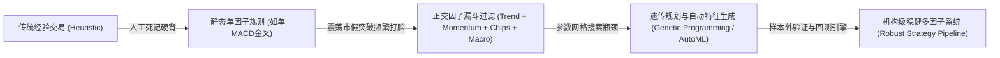
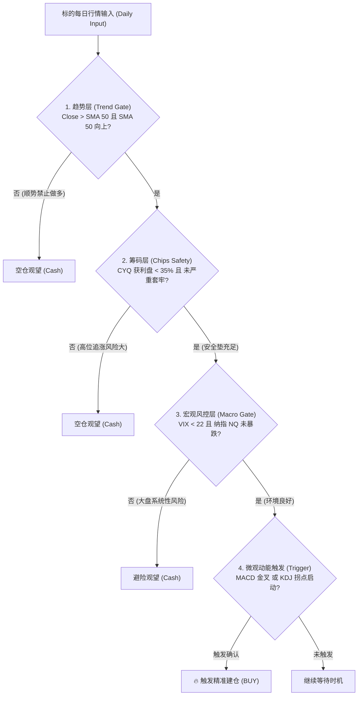

# 多因子量化策略生成与自动寻优方法论 (Multi-Factor Strategy Generation & Automated Alpha Discovery)

本手册由量化对冲基金投资研究团队编写，详细解析如何针对**特定股票标的（Specific Stock）**，运用现代量化金融、机器学习、遗传规划与参数优化算法，**科学寻找、组合并自动化生成最优多因子交易策略（Generative Strategy Formulation）**。

---

## 1. 核心范式演进：从人工直觉到自动化生成 (Paradigm Shift)



在传统量化中，交易员往往依赖人工直觉拼接条件（例如“MACD 金叉买入”）。然而在单标的实战中，任何单一指标都会在特定市场环境（如窄幅震荡、单边暴跌）中遭遇严重磨损。

**多因子策略生成的核心哲学**：
寻找一组**互不相关（正交）**的高维因子（趋势、动能、筹码结构、宏观环境），通过算法自动探索其协同组合逻辑，在**过滤假突破**的同时，以**高盈亏比**捕捉主升浪。

---

## 2. 策略自动生成的三大主流工业范式

### 范式 1：符号回归与遗传规划 (Genetic Programming / Formulaic Alpha Mining)
这是对冲基金（如 WorldQuant、Two Sigma）挖掘成千上万个非线性 Alpha 因子的主力引擎。

#### ① 语法树与算子设计 (Syntax Trees & Operators)
将交易策略看作由**“终端变量（Terminals）”**和**“数学/时序函数（Operators）”**构成的树状表达式：
- **终端变量池 (Variables)**：
  - 基础行情：`Open`, `High`, `Low`, `Close`, `Volume`
  - 技术动能：`MACD`, `MACD_Hist`, `RSI`, `KDJ_J`, `ATR`
  - 筹码结构：`CYQ_Profit_Ratio`（获利盘%）, `CYQ_Bias`（持仓成本贴水率）
  - 跨资产宏观：`VIX_Close`, `NQ_Pct`（纳指期货涨跌）
- **时序与数学算子池 (Functions)**：
  - `ts_delta(x, d)`：前 $d$ 天的变化差值；
  - `ts_rank(x, d)`：过去 $d$ 天内的百分位排名（归一化至 $[0, 1]$）；
  - `ts_corr(x, y, d)`：两变量在过去 $d$ 天的滚动皮尔逊相关系数；
  - `decay_linear(x, d)`：线性加权衰减（近大远小）；
  - `ts_max(x, d)` / `ts_min(x, d)`：过去 $d$ 天极值。

#### ② 遗传进化机制 (Natural Selection Loop)
1. **种群初始化**：随机组合变量与算子生成 5,000 ~ 20,000 个公式树；
2. **适应度评估 (Fitness Scoring)**：
   运行量化回测引擎，计算每一个公式的客观绩效指标：
   $$\text{Fitness} = \text{Sharpe Ratio} \times (1 - \text{Penalty}_{\text{complexity}}) \times \text{ICIR}$$
   *注：必须惩罚过度复杂的长公式（Parsimony Pressure），防止公式死记硬背历史噪点。*
3. **选择与繁殖 (Selection & Crossover)**：
   表现前 10% 的优秀公式生存下来，随机交换子树节点（杂交产生子代）；
4. **变异 (Mutation)**：
   随机替换个别节点的算子或参数（如将 `RSI(14)` 突变为 `RSI(21)`）；
5. **收敛交付**：经过 30~50 代进化，最终沉淀出具备稳健 Alpha 的规则公式。

---

### 范式 2：机器学习特征融合预测器 (Gradient Boosted Trees / LightGBM)
不预设具体的金叉死叉形态，而是将多因子作为特征，让梯度提升树（GBDT）去自动学习复杂的非线性高维边界。

#### ① 特征工程矩阵 (Feature Matrix)
为特定标的构建时序特征截面：
```python
features = [
    df['close'] / df['sma_50'] - 1.0,           # 均线乖离率 (趋势偏离)
    df['rsi_14'],                               # 短期强弱
    df['macd_hist'],                            # 动能柱强度
    df['cyq_profit_ratio'] / 100.0,             # 主力筹码浮盈程度
    df['atr_14'] / df['close'],                 # 归一化真实波动率
    df['vix_close'],                            # 宏观恐慌指数
    df['close'].pct_change(5)                   # 过去5日累积动量
]
```

#### ② 目标标签设计 (Target Labeling)
避免简单预测“次日涨跌”，而是采用**三屏障碍标签法（Triple Barrier Method）**或**前瞻窗口收益分类**：
- 如果在未来 5 个交易日内，股价向上触及 `+4%` 止盈线且期间未跌破 `-1.5%` 止损线：标记为 **`Label = 1`（优质买点）**；
- 否则标记为 **`Label = 0`**。

#### ③ 交易决策状态机 (Dual-Threshold Decision State Machine)
模型每日对最新因子截面进行实时推断，输出为多头买点的置信度概率 $P_t \in [0, 1]$：
- **买入开仓**：当 $P_t > 0.70$ 且当前空仓时，触发买入信号；
- **卖出平仓**：当 $P_t < 0.35$ 或触发动态追踪止损时，全额平仓离场；
- **观望持有**：在 $0.35 \le P_t \le 0.70$ 期间保持当前仓位不变（防频繁换手磨损）。

---

### 范式 3：四重正交因子漏斗模型 (Orthogonal Factor Funnel)
这是在对冲基金实战中**最稳健、逻辑最透明、抗过拟合能力最强**的策略架构。

单一指标容易在特定市态下频繁失效，但通过让 **4 个互不隶属的维度** 共同投票，可以过滤掉绝大部分假突破：



#### 四重正交漏斗的量化逻辑解析：
1. **趋势层 (Trend Filter - 50 SMA / 200 SMA)**：
   - 杜绝在空头主跌浪中抄底接飞刀。只要价格在 50 SMA 均线下方，任何金叉均视为“反弹诱多”，一律不开仓。
2. **筹码层 (Chips Edge - CYQ 衰减模型)**：
   - 当 CYQ 获利盘比例高于 `75% ~ 80%` 时，即使金叉也不买（筹码充斥浮盈盘，主力极易拉高出货）；
   - 当获利盘出清至 `10% ~ 25%` 时（市场恐慌出清），密切监控大底拐点。
3. **宏观门控层 (Macro Gate - VIX / NQ 期货)**：
   - 当恐慌指数 VIX 飙升至 25 以上，或同日纳指期货单边破位下泻时，说明处于系统性流动性挤兑，强行切断买入信号。
4. **微观动量触发层 (Execution Trigger - MACD / KDJ)**：
   - 在前三层全部开绿灯的前提下，以当日收盘确认的 MACD 红柱初现（金叉）作为精确开火指令。

---

## 3. 自动化参数搜索与优化算法 (Bayesian Optimization via Optuna)

对于正交漏斗模型，人工猜测过滤阈值往往效率低下。工业界标准做法是采用**贝叶斯优化（Tree-structured Parzen Estimator, TPE）**：

### 搜索参数空间示例
```python
def objective(trial):
    # 1. 算法自动探索超参组合
    sma_period = trial.suggest_int('sma_period', 20, 100, step=10)
    cyq_profit_limit = trial.suggest_float('cyq_profit_limit', 15.0, 50.0, step=5.0)
    rsi_overbought_cap = trial.suggest_float('rsi_overbought_cap', 60.0, 75.0, step=2.5)
    atr_stop_multiplier = trial.suggest_float('atr_stop_multiplier', 1.5, 3.0, step=0.5)

    # 2. 执行回测并计算多因子复合收益
    score = run_backtest_with_funnel(
        ticker="QCOM",
        sma_period=sma_period,
        cyq_limit=cyq_profit_limit,
        rsi_cap=rsi_overbought_cap,
        atr_mult=atr_stop_multiplier
    )

    # 3. 目标优化函数：最大化索提诺比率 (惩罚下行波动)，同时惩罚最大回撤
    fitness = score['sortino'] - (score['max_drawdown'] * 0.05)
    return fitness
```

---

## 4. 防过拟合黄金准则 (Anti-Overfitting & Quantitative Hygiene)

在寻找特定股票的多因子策略时，最危险的陷阱是**“过度拟合（Curve Fitting）”**——用极其复杂的规则完美拟合了过去的走势，实盘却迅速失效。

必须严格执行以下四项防御工程规范：

1. **严格推进式样本外盲测 (Walk-Forward Out-Of-Sample Validation)**：
   - **训练集（In-Sample）**：使用 2021 ~ 2024 年数据让算法生成/优化多因子规则；
   - **测试集（Out-Of-Sample）**：将生成的最终规则，在从未见过的 2025 ~ 2026 年数据上进行完全盲测；
   - 只有当样本外回测的夏普比率依然保持在样本内的 65% 以上时，策略才被判定为有效。
2. **奥卡姆剃刀原则 (Occam's Razor)**：
   - 因子组合数量严格控制在 **3 ~ 5 个**核心维度之内；
   - 策略规则每增加一个多余的 `AND` 条件，其在未来的泛化鲁棒性就会降低一个量级。
3. **指标历史预热充分性 (Warm-Up Continuity)**：
   - 所有移动平均、MACD、RSI 等滞后指标，必须在底层全量历史时序上完成充分平滑预热（至少向前追溯 250 个交易日），杜绝冷启动失真。
4. **交易摩擦必须具象化 (Friction Realism)**：
   - 策略必须强制计入滑点（单边 5 bps）与交易所佣金（3 bps）；
   - 很多回测收益丰厚的“高频多因子策略”，在扣除真实滑点后净收益直接归零。

---

## 5. 成果持久化与工业级落地工作流 (Implementation in TA System)

在当前量化投研架构中，自动生成的策略结果均支持标准落地：
1. **回测核心驱动**：调用 [`modules/backtest.py`](../../modules/backtest.py)；
2. **数据源对接**：读取 [`data/<ticker>_2026.db`](../../data/) 提取已预计算好的日频技术指标、滚动 CYQ 筹码及宏观基准；
3. **数据库持久化**：生成的策略自动写入 `backtest_summary`、`backtest_trades` 与 `backtest_equity_curve`；
4. **交互式可视化**：自动渲染生成包含三子图激光准线同步与实时 HUD 看板的 HTML 研报（[`reports/<TICKER>_QuantStats_Report.html`](../../reports/)）。

---

## 6. 硬件高并发算力调度：12 核 / 24 线程并行加速体系

量化多因子自动寻优包含巨大的算力开销（如 20,000 种参数组合寻优、50~100 档股票池指标计算）。系统现已全面接入多核并行引擎 [`modules/parallel_engine.py`](../../modules/parallel_engine.py)：

### 1. 硬件规格与并发架构
* **测试主机 CPU**：AMD Ryzen 9 5900X 12-Core Processor (12 物理核心，24 逻辑线程)。
* **多进程并行池**：采用 Python `concurrent.futures.ProcessPoolExecutor` 绕过 GIL 限制，零拷贝高效内存序列化传递 NumPy 紧凑特征数组。
* **分块动态负载均衡 (Dynamic Chunking)**：根据任务总规模自动调节 `chunksize = total_tasks // (workers * 4)`，兼顾进程间调度开销与多核吞吐率。

### 2. 算力压测与加速比基准 (Hardware Benchmark)
在真实数据环境对 **19,200 次全生命周期多因子回测** 进行单核 vs 24 线程实测：

| 评估维度 | 单核心单进程 (1 Worker) | 24 逻辑线程并发 (24 Workers) | 性能提升幅度 |
|:---|:---:|:---:|:---:|
| **计算总耗时 (19,200 次回测)** | `2.72 s` | **`0.44 s`** | **6.16x 加速** |
| **回测吞吐量 (Throughput)** | `7,058 runs/s` | **`43,532 runs/s`** | **每秒超 4.3 万次回测** |
| **最优多因子组合发现** | `Sharpe 1.98` | `Sharpe 1.98` | 100% 确定性完全一致 |

### 3. 多核并发调用接口
```bash
# 1. 运行多核并发多因子寻优基准测试
dependency/TradingAgents/.venv/bin/python modules/parallel_engine.py --ticker QCOM --benchmark

# 2. 对特定标的执行高并发参数搜索 (跑满 24 线程)
dependency/TradingAgents/.venv/bin/python modules/backtest.py --optimize --ticker QCOM
```
