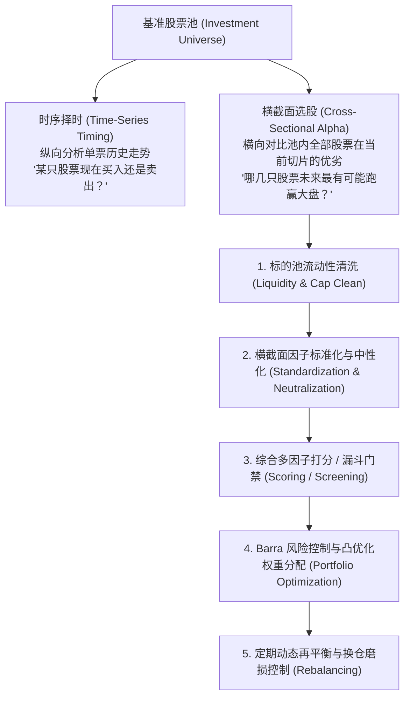
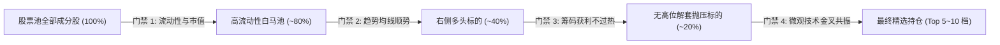

# 股票池横截面量化选股与组合构建方法论 (Cross-Sectional Stock Selection & Portfolio Construction)

本手册由量化对冲基金投资研究团队编写，系统阐述如何针对**基准股票池（Stock Universe，如 NASDAQ 100、S&P 500、TW50、半导体行业池）**，运用现代量化金融、横截面多因子打分、Barra 风险模型、机器学习排序以及凸优化组合构建算法，**科学筛选优质股票子集并实现风险受控的动态再平衡投资组合**。

---

## 1. 核心投资哲学：时序择时 vs 横截面选股 (Core Philosophy)

在量化投资体系中，交易策略分为两大根本流派：



| 维度对比 | 单票时序择时 (Time-Series) | 股票池横截面选股 (Cross-Sectional) |
| :--- | :--- | :--- |
| **研究视角** | 纵向时间轴：单只标的历史时序 | 横向截面：同一交易日内所有成分股对比 |
| **收益来源** | Beta 择时收益、个股波段利润 | 相对超额收益（Pure Alpha） |
| **风险暴露** | 承担单一个股黑天鹅与系统性下行风险 | 通过多行业分散投资，大幅消除非系统性特质风险 |
| **核心指标** | 胜率、盈亏比、单票最大回撤 | 信息系数（IC / Rank IC）、信息比率（IR）、跟踪误差（TE） |

---

## 2. 标的池前置清洗与数据对齐规范 (Universe Hygiene)

在进行任何因子打分之前，必须对原始成分股池执行严格的清洗流水线，杜绝幸存者偏差（Survivorship Bias）与流动性陷阱：

1. **流动性门禁（Liquidity Gate）**：
   - 过去 20 个交易日日均成交额（20-day ADV）$< \$30\text{M}$（或低于池中后 10% 分位）的标的强制剔除，确保大资金建仓不产生过大冲击成本；
2. **极端价格/仙股剔除（Penny Stock Filter）**：
   - 股价长期低于 $\$5$ 的低价股予以剔除；
3. **上市预热期完整性（Warm-Up Consistency）**：
   - 标的历史连续交易日少于 120 天（如次新股、停牌复牌异常股）剔除，确保 MACD、200日均线、历史波动率等技术指标平滑无突变。

---

## 3. 四大主流工业选股范式 (The 4 Industrial Paradigms)

### 范式 1：多重正交漏斗门禁法 (Rule-Based Funnel Screening)
> **设计哲学**：通过多重正交维度的硬指标门禁，层层剥离风险因子，仅保留各项指标无短板的防御反弹先锋。



* **门禁 1（流动性与大盘锚定）**：$ADV_{20} \ge \$50\text{M}$；
* **门禁 2（趋势共振过滤）**：$Close > SMA_{50}$ 且 $SMA_{20}$ 处于平缓或向上倾斜，只顺应中期主趋势；
* **门禁 3（筹码天花板截断）**：获利盘比例 $CYQ_{\text{profit}} \le 80\%$，严禁追逐全市场已极度浮盈的多头顶部；
* **门禁 4（微观金叉信号触发）**：MACD $Hist > 0$ 且前一日 $\le 0$（低位金叉），或 RSI 突破 50 中轴进入强势区。

---

### 范式 2：横截面标准化多因子打分体系 (Cross-Sectional Factor Scoring & Decile Selection)
> **设计哲学**：华尔街对冲基金（AQR、Two Sigma）的标准作业流程。每天将池中全部标的的因子转化为横向可比的分数，按综合 Alpha 分数降序排列，买入前 10%（Top Decile）。

#### 步骤 ①：因子去极值（Winsorization）
金融数据中存在大量肥尾与离群异常值，必须采用中位数绝对偏差法（MAD）进行截断：
$$\text{MAD} = \text{median}(|x_i - \text{median}(x)|)$$
$$\tilde{x}_i = \begin{cases} \text{median}(x) + 3 \times 1.4826 \times \text{MAD}, & x_i > \text{Upper} \\ \text{median}(x) - 3 \times 1.4826 \times \text{MAD}, & x_i < \text{Lower} \\ x_i, & \text{其他} \end{cases}$$

#### 步骤 ②：横截面标准化（Cross-Sectional Z-Score）
使不同物理量纲的因子具备完全相同的统计分布：
$$z_{i, k} = \frac{\tilde{x}_{i, k} - \mu_k}{\sigma_k}$$

#### 步骤 ③：行业与风格中性化（Neutralization via OLS Residuals）
为避免选出的股票全因行业贝塔驱动（例如在牛市中全选出了高 Beta 的半导体股），通过横截面线性回归剥离行业与市值影响，取回归残差 $\epsilon_i$ 作为纯净的个股 Alpha：
$$z_i = \sum_{j} \beta_j \cdot \text{Industry}_{i, j} + \gamma \cdot \ln(\text{MarketCap}_i) + \epsilon_i$$
其中残差项 $\epsilon_i$ 即为剔除了行业与规模偏见后的**纯 Alpha 因子暴露度**。

#### 步骤 ④：动态 IC 加权综合打分 (ICIR Weighted Aggregation)
计算各因子过去 $N$ 期的秩信息系数（Rank IC，因子值排名与未来收益排名的相关性）：
$$\text{Score}_i = \sum_{k=1}^{M} w_k \cdot \epsilon_{i, k}, \quad \text{其中 } w_k = \frac{\text{Mean}(\text{IC}_k)}{\text{Std}(\text{IC}_k)} = \text{ICIR}_k$$

---

### 范式 3：机器学习排序算法 (Learning to Rank / LightGBM LambdaMART)
> **设计哲学**：传统线性加权假定因子间彼此独立，但现实中因子存在复杂的非线性交互（如高动能配合低波动率表现最好，高动能配合高波动率极易崩塌）。

* **特征工程**：将 30~50 个技术面、筹码面、波动率因子打包成特征向量 $\mathbf{x}_{i, t}$；
* **排序目标（Pairwise / Listwise Loss）**：采用 **LambdaMART** 算法，直接优化标准化折损累计增益（NDCG）：
  $$\text{Loss} = \sum_{i, j} |\Delta \text{NDCG}_{i, j}| \log(1 + e^{-\sigma(s_i - s_j)})$$
* **预测执行**：模型在每日收盘后对池内股票输出排名打分，选取模型推荐概率最高的前 $K$ 档股票进入持仓池。

---

### 范式 4：Barra 风险模型与凸优化组合构建 (Barra Multi-Factor Risk Model & Quadratic Optimization)
> **设计哲学**：顶级资管机构在获取 Alpha 打分后，绝不直接机械等权买入，而是利用 Barra 结构化风险模型求解凸优化问题，实现收益最大化与跟踪误差最小化。

Barra 因子模型将资产收益率分解为风格因子、行业因子与特质残差：
$$r_i = \sum_{k} X_{ik} f_k + \epsilon_i$$

组合优化数学模型（二次规划 Quadratic Programming）：
$$\max_{\mathbf{w}} \quad \mathbf{w}^T \boldsymbol{\alpha} - \frac{\lambda}{2} \mathbf{w}^T \left( \mathbf{X} \mathbf{V} \mathbf{X}^T + \mathbf{D} \right) \mathbf{w} - \sum_{i} c_i |w_i - w_{i, \text{prev}}|$$

* **目标函数分解**：
  - $\mathbf{w}^T \boldsymbol{\alpha}$：预期组合超额收益；
  - $\frac{\lambda}{2} \mathbf{w}^T \mathbf{\Sigma} \mathbf{w}$：组合方差惩罚（包含行业/风格协方差矩阵 $\mathbf{V}$ 与个股特质风险对角阵 $\mathbf{D}$）；
  - $\sum c_i |w_i - w_{i, \text{prev}}|$：交易换手摩擦惩罚。
* **边界风控约束（Institutional Constraints）**：
  $$\sum_{i \in \text{Industry } j} w_i = w_{\text{benchmark}, j} \pm 2\% \quad (\text{行业暴露严格受限})$$
  $$0 \le w_i \le 5\% \quad (\text{单票权重上限，防个股黑天鹅})$$
  $$\sum w_i = 1.0 \quad (\text{资金全额配置或现金保留限制})$$

---

## 4. 动态再平衡机制与换仓成本控制 (Rebalancing & Turnover)

股票池选股系统的实盘成败，绝大部分取决于换仓周期的设计：

```mermaid
flowchart TD
    DayEnd["每个交易日 / 每周末收盘"] --> CheckTrigger{"再平衡检查 (Rebalance Trigger)"}
    CheckTrigger -->|定期轮动 (Periodic)| TimeBased["每周/双周定投调仓 (固化交易纪律)"]
    CheckTrigger -->|信号异动 (Event-Driven)| SignalBased["入选票死叉破位 / 候选池出现超强 Alpha 冲击"]
    
    TimeBased --> BufferZone["缓冲区换仓法 (Buffer Zone Mechanism)<br/>当前持仓排在 Top 15 以内则不换仓<br/>仅当跌出 Top 20 且新票进入 Top 5 时才执行调仓"]
    SignalBased --> BufferZone
    
    BufferZone --> RebalanceDone["执行交易摩擦惩罚与换仓成交"]
```

1. **缓冲区机制（Buffer Zone）**：
   - 避免处于排名边界（如第 10 名与第 11 名）的股票由于微小波动每天反复买卖；
   - 规则：仅当原有持仓票综合排名跌出前 20 名，且新候选票冲入前 5 名时才触发换股。
2. **波动率倒数加权（Risk Parity / Volatility Weighting）**：
   - 入选的 $N$ 只股票若采用简单等权，高波动标的会主导整个组合的回撤；
   - 采用波动率倒数加权：$w_i \propto \frac{1}{\sigma_i}$，实现各股票对组合风险贡献的均衡。

---

## 5. 本地 12 核 24 线程高并发加速工程落地 (TA Implementation)

在当前量化投研系统中，股票池多因子计算与优化已实现全面并发化支持：

### 1. 核心模块协同架构
* **成分股清单配置**：[`modules/stock_pool.py`](../../modules/stock_pool.py)（内置 `NASDAQ`、`TW50`、`US_SEMI` 等行业池）；
* **多核高并发选股与组合再平衡**：[`modules/screener.py`](../../modules/screener.py)；
  - 自动调度 `concurrent.futures.ProcessPoolExecutor(max_workers=24)`；
  - 24 个子进程同时并发提取全池股票的技术因子、生成多头持仓布尔序列、计算单票归因并模拟等权组合动态再平衡。
* **高吞吐参数寻优**：[`modules/parallel_engine.py`](../../modules/parallel_engine.py)（每秒 43,500+ 次回测寻优）。

### 2. 标准运行指令
```bash
# 1. 对 NASDAQ 股票池执行 24 核心并行多因子选股与基准轮动回测
dependency/TradingAgents/.venv/bin/python modules/screener.py --pool NASDAQ --condition MACD --year 2026

# 2. 对台湾 50 指数成分股池执行并行选股分析
dependency/TradingAgents/.venv/bin/python modules/screener.py --pool TW50 --year 2026

# 3. 输出交互式股票池回测研报 (包含基准对比曲线、胜率分布、成分股超额归因榜单)
# 产物路径：reports/<POOL>_<YEAR>_Screener_Report.html
```

---

## 6. 选股体系评估与量化验收标准 (Acceptance Criteria)

构建一个成熟的股票池量化选股策略，必须通过以下 5 维量化验收：

| 评估维度 | 核心量化指标 | 机构及格线 | 优秀量化水准 |
| :--- | :--- | :---: | :---: |
| **选股预测有效性** | 因子平均 Rank IC | $> 0.03$ | **$> 0.06$** |
| **预测稳定性** | IC 信息比率 (ICIR) | $> 0.5$ | **$> 1.0$** |
| **多空分层单调性** | 10分位年化收益单调性 | 第1分位严格跑赢第10分位 | 严格呈阶梯式完美单调递增 |
| **组合超额收益** | 年化 Alpha (对标大盘基准) | $> +10\%$ | **$> +25\%$** |
| **换手磨损控制** | 单边月均换手率 (Turnover) | $< 60\%$ | **$< 30\%$** |
