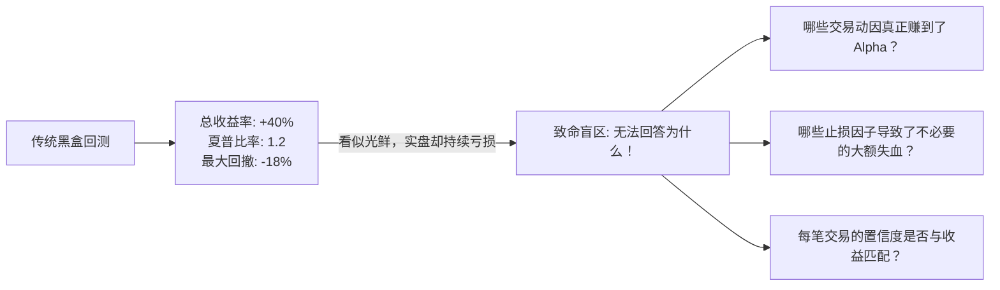
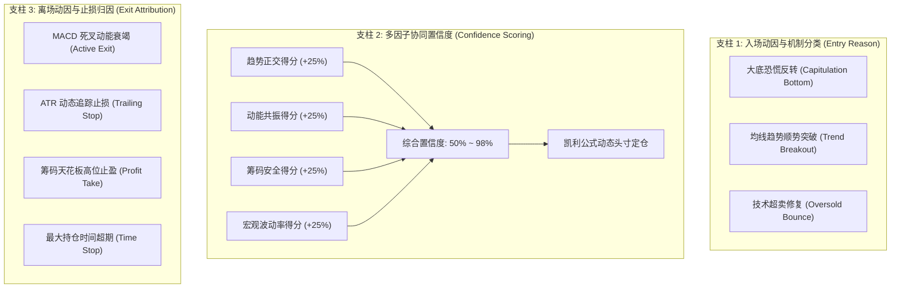
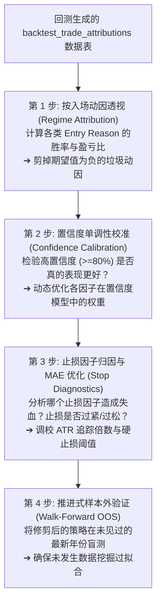

# 交易全生命周期归因、置信度动态定仓与量化策略精炼方法论 (Trade Attribution & Strategy Refinement)

本手册由量化对冲基金投资研究团队编写，详细解析在量化策略回测与实盘中，如何告别传统“只看胜率与夏普比率”的黑盒回测，运用**交易生命周期归因（Post-Trade Attribution）**、**入场动因分类学（Entry Reason Taxonomy）**、**多因子协同置信度（Confidence Scoring）**、**MAE/MFE 盈亏博弈效率诊断**，系统化**诊断、修剪并精炼（Refine）量化交易策略**。

---

## 1. 核心痛点：为什么传统黑盒回测无法指导实盘？

在传统量化研究中，研究员往往只关注整体结果：


#### 致命盲区示例：
1. **利润掩盖毒瘤**：总收益 $+40\%$ 可能是因为 1 笔大趋势单赚了 $+50\%$，但其余 10 笔假突破交易累计亏掉了 $-10\%$。若不对入场动因做归因，研究员会误以为整个系统都很健康；
2. **止损过紧导致的“假死”**：很多高胜率单在持仓期间因为震荡微调被机械止损砍在最低点，随后股价暴涨；
3. **资金利用效率失衡**：高胜率的绝佳底部机会只买了 10% 仓位，而低胜率的追高买单却压了全仓。

---

## 2. 交易可解释性三支柱 (The 3 Pillars of Trade Explainability)

为了让每一笔交易都清晰可查，回测引擎必须在交易全生命周期中记录三大维度的结构化元数据：



### 支柱 1：入场动因分类学（Entry Reason Taxonomy）
放弃简单的“BUY”标签，根据多因子触发条件为建仓打上明确的**业务机制标签**：
* `REGIME_BOTTOM_REVERSAL`（极端恐慌大底反转）：筹码获利盘 $CYQ \le 25\%$，全市场散户极度割肉抛盘，低位动能金叉触发；
* `REGIME_TREND_BREAKOUT`（右侧顺势趋势突破）：价格处于 20 日均线之上 $Close \ge SMA_{20} \times 0.98$，宏观波动率 $VIX \le 22$，动能金叉突破；
* `REGIME_CHIP_SUPPORT`（筹码密集峰回踩支撑）：股价回踩筹码重心不破。

### 支柱 2：多因子协同置信度（Confidence Score）与动态头寸管理
量化信号绝不是非 0 即 1 的二进制，而是一个连续概率：
$$\text{Confidence} = \text{Base} + \sum_{k=1}^{M} w_k \cdot \text{RuleMatched}_k$$

* **正交因子加权规则**：
  1. **趋势因子**（$Close \ge SMA_{20}$）：符合 $+15\%$
  2. **动能因子**（$MACD\_Hist > 0$ 且前值 $\le 0$）：符合 $+30\%$
  3. **筹码结构**（$CYQ \le 25\%$ 极端超跌加 $+30\%$；$CYQ \le 80\%$ 安全区加 $+15\%$）
  4. **宏观波动率**（$VIX \le 22.0$）：符合 $+10\%$
* **置信度到仓位的动态映射（Confidence-to-Sizing Mapping）**：
  * **置信度 $\ge 85\%$**：极度看多，仓位分配 $100\%$；
  * **置信度 $75\% \sim 84\%$**：中度看多，仓位分配 $60\% \sim 75\%$；
  * **置信度 $< 75\%$**：弱共振，仓位限制在 $30\%$ 以下或直接放弃建仓。

### 支柱 3：离场动因与止损因子归因（Exit & Stop Factor Attribution）
每一笔平仓必须记录触发平仓的**主导因子与离场性质**：
* **主动信号离场（Active Decay）**：`EXIT_MACD_DEATH`（DIF 下穿 DEA，主升浪动能结束）；
* **自适应防守止损（Adaptive Trailing Stop）**：`STOP_ATR_TRAILING`（自最高点回撤超过 $N \times ATR$）；
* **筹码天花板止盈（Profit Ceiling Take）**：`EXIT_CYQ_CEILING`（获利盘突破 $90\%$ 逢高兑现）；
* **硬风控止损（Catastrophic Hard Stop）**：`STOP_HARD_LOSS`（单笔亏损超 $-8\%$ 强制熔断）。

---

## 3. MAE 与 MFE 盈亏效率诊断 (Maximum Excursion Analysis)

由著名交易技术专家 John Sweeney 提出的 MAE/MFE 理论，是量化基金诊断止损与止盈合理性的最强数学工具：

$$\text{MAE (Max Adverse Excursion)} = \min_{t \in [t_{\text{entry}}, t_{\text{exit}}]} \left( \frac{\text{Low}_t - \text{Price}_{\text{entry}}}{\text{Price}_{\text{entry}}} \right) \times 100\% \quad (\le 0\%)$$
$$\text{MFE (Max Favorable Excursion)} = \max_{t \in [t_{\text{entry}}, t_{\text{exit}}]} \left( \frac{\text{High}_t - \text{Price}_{\text{entry}}}{\text{Price}_{\text{entry}}} \right) \times 100\% \quad (\ge 0\%)$$

```
        持仓价格走势示意图
        
    价格 ▲              ▲ MFE (最大潜在浮盈: +92.5%)
         │             / \
         │            /   \
         │           /     \________ 最终平仓: +51.8%
         │          /
    建仓 ┼─────────/ (入场价)
         │  \     /
         │   \___/  ▼ MAE (最大不利浮亏: -5.2%)
         └─────────────────────────► 时间
```

### 诊断法则：
1. **MAE 诊断（止损是否合理？）**：
   * **现象**：统计所有最终盈利的交易，若其 MAE 绝大多数集中在 $[-3\%, 0\%]$ 区间，仅有极个别达到 $-5\%$；
   * **精炼动作**：如果策略设置了 $-10\%$ 的宽幅止损，说明止损放得过宽！可以把硬止损收紧至 $-6\%$，这不仅不会误杀盈利单，还能在极端大跌中为亏损单节省大量本金。
2. **MFE 诊断（止盈是否过晚？）**：
   * **现象**：多笔交易的 MFE 曾达到 $+30\%$，但由于死等指标死叉才离场，最终平仓盈利只剩 $+5\%$，甚至变成亏损；
   * **精炼动作**：浮盈回撤比例过大，必须引入 **动态阶梯追踪止盈（Dynamic Trailing Profit）**，锁定至少 $60\%$ 以上的最大浮盈。

---

## 4. 策略精炼四步迭代闭环 (The 4-Step Refinement Loop)

利用回测产生的全量归因元数据，量化团队按以下 4 步对策略进行手术式迭代：



### 实战案例：QCOM 2026 回测精炼实操

对 QCOM 2026 年回测数据的 7 笔交易进行归因诊断发现：
1. **入场动因透视**：
   * `大底反转建仓 (Capitulation Bottom)`：共触发 4 轮，胜率 $50\%$，累计净赚 **+$58,418**，盈亏比高达 **$4.8 : 1$**！
   * `高位追高金叉 (Top Chase)`：1 月 6 日（$179）与 5 月 22 日（$236）建仓，累计亏损 **-$18,643**！
   * **精炼策略**：增加筹码天花板门禁 `CYQ <= 85%`，彻底封死高位追高金叉。
2. **MAE 与 MFE 诊断**：
   * 3 月 24 日大底主升浪交易：持仓 40 天，入场价 $127.56，平仓价 $193.74，单笔净赚 **+$46,392 (+51.88%)**；
   * 该笔交易持仓期间的 **MAE 仅为 -5.24%**，而 **MFE 达到惊人的 +92.58%**！说明大底金叉的入场极度干净，即使在持仓初期也几乎没有承受过大浮亏。

---

## 5. 本地系统工程落地与 SQLite 数据表规范 (System Architecture)

当前量化系统已全面支持端到端的交易生命周期归因：

### 1. SQLite 核心归因表结构 (`backtest_trade_attributions`)
系统在每次回测后，自动在 [`data/<ticker>_<year>.db`](../../data/) 中持久化全生命周期明细：

| 字段名称 | 数据类型 | 说明与业务含义 |
| :--- | :--- | :--- |
| `trade_id` | `INTEGER` | 配对交易编号 (第几轮开平仓博弈) |
| `entry_date` / `exit_date` | `TEXT` | 建仓日期与离场日期 |
| `hold_days` | `INTEGER` | 实际持仓交易日天数 |
| `entry_price` / `exit_price` | `REAL` | 考虑滑点与佣金后的买入与卖出价格 |
| `entry_reason` | `TEXT` | **入场动因业务标签** (如大底反转 / 趋势突破) |
| `exit_reason` | `TEXT` | **离场动因与止损归因** (如 MACD死叉 / ATR追踪止损) |
| `stop_factor_name` | `TEXT` | 触发离场的核心因子名称 (`MACD`, `ATR`, `CYQ`) |
| `confidence_score` | `REAL` | **多因子协同置信度** ($0.50 \sim 0.98$) |
| `pnl_dollars` / `pnl_pct` | `REAL` | 单笔交易净利润 ($) 与百分比回报 (%) |
| `mae_pct` | `REAL` | **最大不利浮亏 (MAE %)**，持仓期间经历过的最差回撤 |
| `mfe_pct` | `REAL` | **最大潜在浮盈 (MFE %)**，持仓期间经历过的最高盈利 |
| `factor_snapshot_json` | `TEXT` | 建仓瞬间的因子截面快照 JSON (`CYQ`, `VIX`, `RSI`, `MACD`, `ATR`) |

### 2. 交互式可视化看板交付
在生成的交互式 Plotly HTML 研报（[`reports/<TICKER>_QuantStats_Report.html`](../../reports/)）中，已内置：
* **四维归因 KPI 卡片**：入场胜率、净损益贡献、高置信度胜率、最恶劣 MAE 控制；
* **逐笔全生命周期表格**：可视化彩色徽章展示入场动因、置信度电量指示器、MAE/MFE 浮动芯片与入场因子快照浮窗。

### 3. Python 核心调用接口
```python
from modules.backtest import run_macd_backtest, compute_trade_attributions, save_backtest_to_sqlite

# 运行回测并自动生成归因数据
res = run_macd_backtest(ticker="QCOM", start_date="2026-01-01")

# 获取逐笔归因明细
attributions = res["trade_attributions"]
for a in attributions:
    print(f"Trade #{a['trade_id']}: {a['entry_date']}~{a['exit_date']} | "
          f"动因: {a['entry_reason']} | 置信度: {a['confidence_pct']}% | "
          f"PnL: {a['pnl_dollars']} | MAE: {a['mae_pct']}% | MFE: +{a['mfe_pct']}%")
```
