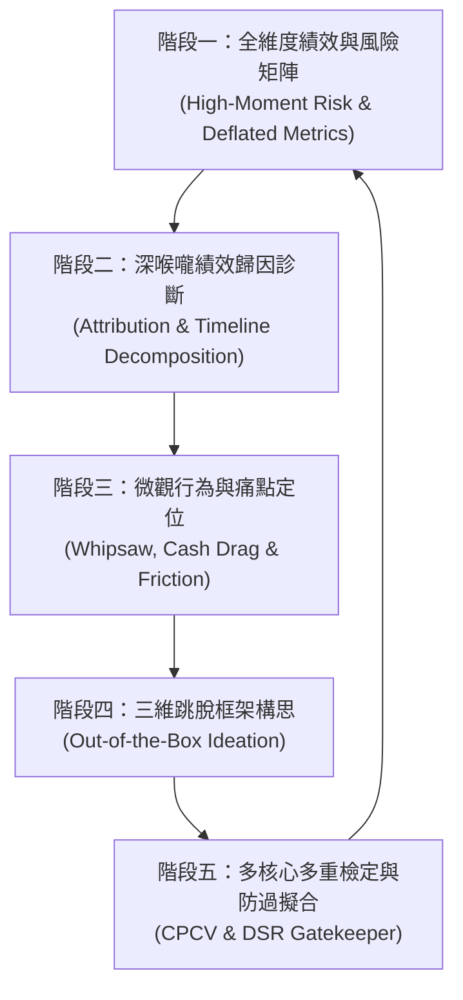

# 經典與學術級量化策略績效覆盤與演進工作流 (Institutional & Academic Quantitative Review Workflow)

本手冊融合現代買方對沖基金（AQR、Bridgewater、Two Sigma）與學術界微觀計量金融學（López de Prado、Grinold & Kahn、Brinson）的標準化研發閉環，定義了策略從「績效評估」、「深喉嚨歸因診斷」到「跳脫框架迭代」的標準作業程序 (SOP)。

---

## 🏛️ 核心工作流架構總覽 (Workflow Architecture)

一個健全的量化策略覆盤並非「看回測賺多少錢」，而是透過系統化的五步閉環，將運氣、市場 Beta、風格溢價與真正的超額 Alpha 嚴格剝離：



---

## 階段一：全維度計量績效與高階矩風險評估 (High-Moment Metrics)

傳統夏普比率（Sharpe Ratio）假設收益率服從獨立同分佈（IID）的正態分佈，在具有厚尾、偏態與跳躍的股票市場中容易產生嚴重的「過度樂觀估計」。

### 1. 核心評估指標清單
1. **下行風險比率 (Downside Metrics)**：
   - **索提諾比率 (Sortino Ratio)**：$\frac{R_p - R_f}{\sigma_{\text{downside}}}$，僅對負報酬進行懲罰，衡量下行破壞力。
   - **卡瑪比率 (Calmar Ratio)**：$\frac{\text{年化收益率}}{\text{最大回撤 (MDD)}}$，直接考驗回撤恢復速度。
2. **偏態與峰度檢定 (Skewness & Kurtosis)**：
   - 若收益分佈呈現負偏態（$\gamma_3 < 0$）或超額厚尾（$\gamma_4 > 0$），意味著策略隱含「撿芝麻漏西瓜」的左尾崩潰風險。
3. **通膨夏普比率防偽 (Deflated Sharpe Ratio - DSR)**（*López de Prado, 2014*）：
   - 當進行多參數網格搜索時，測試了 $N$ 組參數，最大夏普比率純粹靠隨機運氣產生的期望值 $\mathbb{E}[\max_{SR}]$ 會隨 $N$ 增加而大幅膨脹。
   - 透過 DSR 公式計算出在考慮「多重檢驗偏誤 (Multiple Testing Bias)」後，真實夏普比率大於 0 的統計顯著性機率。若 $\text{DSR} < 0.95$，該回測結果直接判定為假突破/過擬合！

---

## 階段二：三位一體績效歸因體系 (Three-Tier Attribution)

回答「**策略究竟從哪裡賺到錢？又在哪裡賠掉錢？**」

```
┌────────────────────────────────────────────────────────┐
│ 1. 宏觀因子歸因 (Macro & Style Factor Attribution)     │
│    R_p - R_f = α + β_market * MKT + β_size * SMB + ...  │
│    -> 剝離大盤 Beta 與市值/動量因子，確認是否存在真 Alpha│
├────────────────────────────────────────────────────────┤
│ 2. 時序狀態歸因 (Timeline & Cash Drag Attribution)      │
│    總週期 = 【持股主升段】+【假摔停利點】+【場外空倉等待】 │
│    -> 計算場外持幣的機會成本 (Cash Drag)                │
├────────────────────────────────────────────────────────┤
│ 3. 交易摩擦歸因 (Friction & Microstructure Attribution)│
│    Gross PnL - (佣金 + 證交稅 + 滑價衝擊) = Net PnL     │
│    -> 評估周轉率過高帶來的無謂損耗                      │
└────────────────────────────────────────────────────────┘
```

---

## 階段三：微觀行為與痛點定位 (Microstructure Diagnostics)

當發現策略回報不理想或回撤偏大時，進行深層診斷的具體檢驗步驟：

1. **時序切片檢視 (Temporal Slicing)**：
   - 繪製持倉狀態（0/1 序列）與標的價格疊加圖；
   - 檢視策略「空倉期」標的走勢：若標的在策略空倉時持續大漲，代表策略存在**「早洩停利 (Premature Exit)」**或**「過度防守踏空」**的痛點。
2. **假摔洗盤檢驗 (Whipsaw Diagnosis)**：
   - 聚焦每一筆「因觸發停利/停損而賣出」的交易；
   - 統計平倉後 3 日、5 日、10 日的股價走勢。若賣出後 5 日內標的強勢收復跌幅創高比例 $> 50\%$，代表固定比例的止盈/止損條件遭受市場雜訊與主力洗盤嚴重干擾。
3. **多空雙方微觀資金博弈 (Microstructure Imbalance)**：
   - 檢查賣出當日的委買委賣單流、內外盤比率、三大法人買賣超結構。確認是「全面潰逃」還是「單一主體避險（如外資期貨套利）」。

---

## 階段四：三維跳脫框架構思法 (Three-Dimensional Ideation)

當定位出痛點（例如：被外資假摔洗出場導致空倉踏空）後，如何構思改良方案？

### 維度 1：市場生態博弈思維 (Institutional Counter-Play)
- **哲學**：金融市場不是單純的幾何價格線，而是不同利益訴求機構（外資、本土基金、官股、散戶）的博弈。
- **思考路徑**：
  - 外資大賣一定是看壞嗎？可能是美股下跌被動提款或期貨套利；
  - 誰是最了解在地基本面的？本土公募投信；
  - **誕生方案**：*引入「投信逆勢護盤免死金牌」*，當外資砸盤但投信逆勢承接且守住長線生命線時，判定為假摔，暫緩清倉。

### 維度 2：部位階梯執行架構 (Execution & Sizing Engineering)
- **哲學**：拒絕工程師思維中非黑即白的二元對立（0% 或 100%）。
- **思考路徑**：
  - 遇到恐慌黑 K，既想保住利潤，又怕賣在最低點怎麼辦？
  - 權值股急殺後具備極高機率的次日均值回歸反彈；
  - **誕生方案**：*分批階梯停利 (Tiered Scaling Out)*，當天僅賣出 30% 保底鎖利，保留 70% 部位等待次日均值回歸的高價反彈點出清。

### 維度 3：跨市場衍生品與宏觀信號聯動 (Cross-Market Derivatives)
- **哲學**：現貨價格是衍生品博弈的投影。
- **思考路徑**：
  - 大機構在現貨砸盤前，會在期權或期貨市場留下什麼蛛絲馬跡？
  - 台積電是加權指數的絕對權值主宰，期貨淨空單水位是先行風向標；
  - **誕生方案**：*外資台指期未平倉 (Futures Net OI) 動態對沖*，在極端空單水位時主動減碼現貨風險敞口。

---

## 階段五：實證檢驗與防過擬合守門 (Empirical Validation & CPCV)

構思出新策略後，嚴禁直接採納，必須經過嚴格的計量防禦檢驗：

1. **多核心並行網格搜尋 (Multi-Core Parameter Sweep)**：
   - 善用 CPU 多核心，針對新增參數進行大範圍密集掃描，檢驗參數在目標區間內是否具備「高原特徵 (Parameter Plateau)」，嚴防孤立尖峰（Overfitting Spike）。
2. **多基準橫向交叉評估 (Multi-Benchmark Scorecard)**：
   - 策略必須同時與**「個股買入持有基準」**與**「市場總體指數基準」**橫向對比。
   - 核心標準：**在多頭市場中捕獲至少 85%~90% 以上漲幅，同時在回撤期消滅 30%~50% 以上的最大回撤**。
3. **事後穩健性檢定**：
   - 檢定勝率、獲利因子 (Profit Factor)、卡瑪比率與前述 DSR 統計顯著性。
