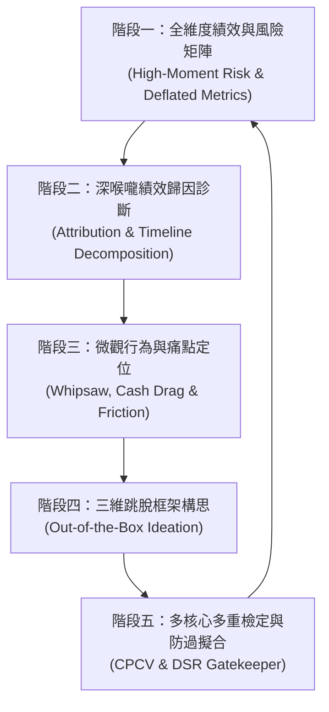

# 經典與學術級量化策略績效覆盤與演進工作流 (Institutional & Academic Quantitative Review Workflow)

本手冊融合現代買方對沖基金（AQR、Bridgewater、Two Sigma）與學術界微觀計量金融學（López de Prado、Grinold & Kahn、Brinson）的標準化研發閉環，定義了策略從「績效評估」、「深喉嚨歸因診斷」到「跳脫框架迭代」的標準作業程序 (SOP)。

---

## 🏛️ 核心工作流架構總覽 (Workflow Architecture)

一個健全的量化策略覆盤並非「看回測賺多少錢」，而是透過系統化的五步閉環，將運氣、市場 Beta、風格溢價與真正的超額 Alpha 嚴格剝離：



---

## 階段一：全維度計量績效與高階矩風險評估 (High-Moment Metrics)

傳統夏普比率（Sharpe Ratio）假設收益率服從獨立同分佈（IID）的正態分佈，在具有厚尾、偏態與跳躍的股票市場中容易產生嚴重的「過度樂觀估計」。

### 1. 核心評估指標清單
1. **下行風險比率 (Downside Metrics)**：
   - **索提諾比率 (Sortino Ratio)**：$\frac{R_p - R_f}{\sigma_{\text{downside}}}$，僅對負報酬進行懲罰，衡量下行破壞力。
   - **卡瑪比率 (Calmar Ratio)**：$\frac{\text{年化收益率}}{\text{最大回撤 (MDD)}}$，直接考驗回撤恢復速度。
2. **偏態與峰度檢定 (Skewness & Kurtosis)**：
   - 若收益分佈呈現負偏態（$\gamma_3 < 0$）或超額厚尾（$\gamma_4 > 0$），意味著策略隱含「撿芝麻漏西瓜」的左尾崩潰風險。
3. **通膨夏普比率防偽 (Deflated Sharpe Ratio - DSR)**（*López de Prado, 2014*）：
   - 當進行多參數網格搜索時，測試了 $N$ 組參數，最大夏普比率純粹靠隨機運氣產生的期望值 $\mathbb{E}[\max_{SR}]$ 會隨 $N$ 增加而大幅膨脹。
   - 透過 DSR 公式計算出在考慮「多重檢驗偏誤 (Multiple Testing Bias)」後，真實夏普比率大於 0 的統計顯著性機率。若 $\text{DSR} < 0.95$，該回測結果直接判定為假突破/過擬合！

---

## 階段二：三位一體績效歸因體系 (Three-Tier Attribution)

回答「**策略究竟從哪裡賺到錢？又在哪裡賠掉錢？**」

```
┌────────────────────────────────────────────────────────┐
│ 1. Brinson (BHB / BF) 產業配置 vs 選股歸因             │
│    Active Return = Allocation + Selection + Interaction│
│    -> 區分「押對強勢產業」vs「同業內挑對真龍頭 Alpha」   │
├────────────────────────────────────────────────────────┤
│ 2. CAPM Alpha/Beta 與因子消融歸因 (Factor Attribution) │
│    R_p - R_f = α + β * (R_b - R_f) + ε                 │
│    -> 剝離市場 Beta，並以 Leave-One-Out 量化各因子貢獻  │
├────────────────────────────────────────────────────────┤
│ 3. 時序狀態與交易摩擦歸因 (Cash Drag & Friction)       │
│    Gross PnL - (佣金 + 證交稅 + 滑價) = Net PnL         │
│    -> 計算空倉機會成本、個股集中度與周轉率損耗          │
└────────────────────────────────────────────────────────┘
```

### 2.1 Brinson 雙模型標準拆解 (BHB & BF)
設組合與基準在產業 $i$ 之權重與報酬分別為 $(w_{p,i}, R_{p,i})$、$(w_{b,i}, R_{b,i})$，基準總報酬為 $R_b = \sum_i w_{b,i} R_{b,i}$：
- **配置效應 ($A_i$)**：
  - **BHB (Brinson-Hood-Beebower)**：$(w_{p,i} - w_{b,i}) \cdot R_{b,i}$
  - **BF (Brinson-Fachler，主判決口徑)**：$(w_{p,i} - w_{b,i}) \cdot (R_{b,i} - R_b)$（扣除大盤總報酬，超配跑輸大盤的弱勢產業會正確顯示負貢獻）
- **選股效應 ($S_i$)**：$w_{b,i} \cdot (R_{p,i} - R_{b,i})$
- **交互效應 ($I_i$)**：$(w_{p,i} - w_{b,i}) \cdot (R_{p,i} - R_{b,i})$（實務常將 $S_i + I_i$ 合併為「總選股效應」）
- **多期連結與裁決**：多換倉期採 Carino 連結確保 $\sum (A_i + S_i + I_i) \equiv R_p - R_b$；若總選股效應佔比 $\ge 60\%$ 判為 `PURE_SELECTION_ALPHA`，若配置效應佔比 $\ge 60\%$ 判為 `SECTOR_BET_DRIVEN`（需檢查單一產業集中度上限）。

### 2.2 CAPM 風格回歸、個股集中度與因子消融
- **CAPM 回歸**：輸出年化 Jensen's Alpha（含 `t-stat`）、市場 `Beta`、$R^2$、Tracking Error 與 Information Ratio，確認是否以低 Beta 賺取顯著真 Alpha。
- **個股集中度**：列出前 10 大淨損益個股與 Top 3 佔總淨利比例，嚴防「1 檔飆股掩蓋 9 檔毒瘤」。
- **因子邊際消融 (Leave-One-Out)**：搭配 [`@prompts/factors.md`](../factors.md) 逐一拔除單因子重跑，輸出 $\Delta\text{Return}$ / $\Delta\text{Sharpe}$ / $\Delta\text{MDD}$ 定位核心引擎與拖油瓶。

### 2.3 MAE / MFE 與洗盤賣飛審計（對應階段三）
- 針對所有交易計算持有期最大浮虧 **MAE** 與最大浮盈 **MFE**；針對非基本面換倉之技術出場單，統計出場後 5 / 10 / 20 日反彈創高比例（**洗盤賣飛率**）與出場後平均漲跌，量化是否過早停利（可透過 `python -m modules.attribution_decay` 一鍵執行完整五大模組）。

---

## 階段三：微觀行為與痛點定位 (Microstructure Diagnostics)

當發現策略回報不理想或回撤偏大時，進行深層診斷的具體檢驗步驟：

1. **時序切片檢視 (Temporal Slicing)**：
   - 繪製持倉狀態（0/1 序列）與標的價格疊加圖；
   - 檢視策略「空倉期」標的走勢：若標的在策略空倉時持續大漲，代表策略存在**「早洩停利 (Premature Exit)」**或**「過度防守踏空」**的痛點。
2. **假摔洗盤檢驗 (Whipsaw Diagnosis)**：
   - 聚焦每一筆「因觸發停利/停損而賣出」的交易；
   - 統計平倉後 3 日、5 日、10 日的股價走勢。若賣出後 5 日內標的強勢收復跌幅創高比例 $> 50\%$，代表固定比例的止盈/止損條件遭受市場雜訊與主力洗盤嚴重干擾。
3. **多空雙方微觀資金博弈 (Microstructure Imbalance)**：
   - 檢查賣出當日的委買委賣單流、內外盤比率、三大法人買賣超結構。確認是「全面潰逃」還是「單一主體避險（如外資期貨套利）」。

---

## 階段四：三維跳脫框架構思法 (Three-Dimensional Ideation)

當定位出痛點（例如：被外資假摔洗出場導致空倉踏空）後，如何構思改良方案？

### 維度 1：市場生態博弈思維 (Institutional Counter-Play)
- **哲學**：金融市場不是單純的幾何價格線，而是不同利益訴求機構（外資、本土基金、官股、散戶）的博弈。
- **思考路徑**：
  - 外資大賣一定是看壞嗎？可能是美股下跌被動提款或期貨套利；
  - 誰是最了解在地基本面的？本土公募投信；
  - **誕生方案**：*引入「投信逆勢護盤免死金牌」*，當外資砸盤但投信逆勢承接且守住長線生命線時，判定為假摔，暫緩清倉。

### 維度 2：部位階梯執行架構 (Execution & Sizing Engineering)
- **哲學**：拒絕工程師思維中非黑即白的二元對立（0% 或 100%）。
- **思考路徑**：
  - 遇到恐慌黑 K，既想保住利潤，又怕賣在最低點怎麼辦？
  - 權值股急殺後具備極高機率的次日均值回歸反彈；
  - **誕生方案**：*分批階梯停利 (Tiered Scaling Out)*，當天僅賣出 30% 保底鎖利，保留 70% 部位等待次日均值回歸的高價反彈點出清。

### 維度 3：跨市場衍生品與宏觀信號聯動 (Cross-Market Derivatives)
- **哲學**：現貨價格是衍生品博弈的投影。
- **思考路徑**：
  - 大機構在現貨砸盤前，會在期權或期貨市場留下什麼蛛絲馬跡？
  - 台積電是加權指數的絕對權值主宰，期貨淨空單水位是先行風向標；
  - **誕生方案**：*外資台指期未平倉 (Futures Net OI) 動態對沖*，在極端空單水位時主動減碼現貨風險敞口。

---

## 階段五：實證檢驗與穩健性守門 (Empirical Validation & Robustness Gatekeeper)

構思出新策略後，嚴禁直接採納，必須統一調用 **[`@prompts/analyze/robustness_testing_taxonomy.md`](../analyze/robustness_testing_taxonomy.md)** 作為系統級驗收閘門，完成以下三項核心防禦檢驗並產出六維計分卡：

1. **前進式滾動驗證 (WFO) 與防偽檢定 (CPCV / DSR)**：
   - 依 `IS/OOS` 滾動盲跑檢驗 `WFE >= 50%` 與 `DSR >= 95%`，確保無樣本外崩壞或多重檢定偏誤。
2. **參數高原與滑價壓力測試**：
   - 檢驗核心參數 `±20%` 鄰域高原穩定性與 `0.05% -> 0.5%` 滑價衰減斜率，嚴防孤立尖峰與紙上富貴。
3. **多基準橫向交叉評估 (Multi-Benchmark Scorecard)**：
   - 策略必須同時與**「個股買入持有基準」**與**「市場總體指數基準」**橫向對比：在多頭市場捕獲至少 `85%~90%` 以上漲幅，同時在回撤期消滅 `30%~50%` 以上最大回撤。
